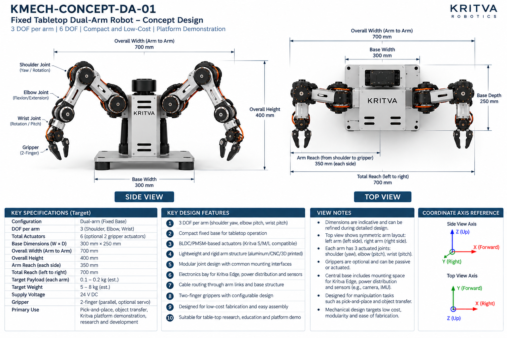
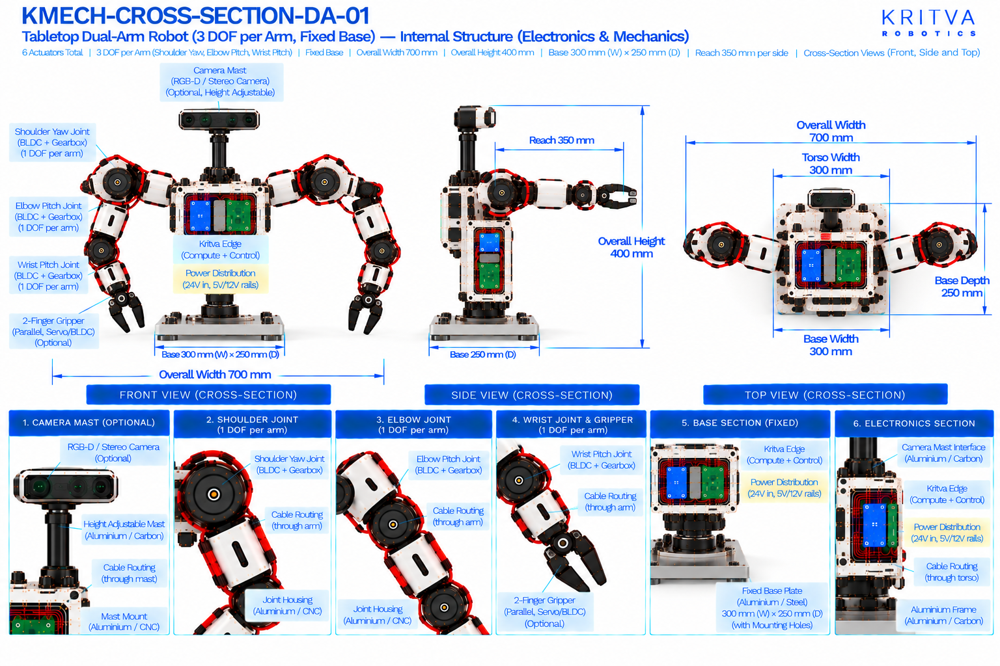

# DA-01 — Fixed Tabletop Dual-Arm

| Property | Value |
|---|---|
| Document ID | KMECH-CONCEPT-DA-01 |
| Repository | `KritvaOS/kritva-mechanical` |
| Document Type | Concept Overview |
| Status | PROPOSED |
| Owner | Dinesh |
| Assigned Intern | INTERN-01 |
| Version | 0.3.0 |
| Last Updated | 2026-10-31 |
| Authority | Feasibility study; subject to owner review |
| Related Documents | `feasibility/STUDY_PLAN.md`, `feasibility/REQUIREMENTS_REGISTER.md`, `docs/images/ARTWORK_MANIFEST.json`, `REQUIREMENTS.md`, `ARCHITECTURE.md` |

## 1. Purpose and Scope

DA-01 is the simplest dual-arm concept in the study: two 3-DOF arms on a compact fixed tabletop base, intended for pick-and-place, object transfer and Kritva platform demonstration. It is the low-complexity reference against which the other dual-arm concepts are compared. This README records what the two artwork sheets print and what the intern must investigate; it does not approve any value.

- Concept ID: DA-01
- Concept name: Fixed Tabletop Dual-Arm
- Family: Dual-arm
- Complexity: Low (relative engineering category, not a validated assessment)
- Assigned intern: INTERN-01
- Assessment revision: none yet (NOT STARTED)

## 2. Reference Artwork

*Concept sheet: `docs/images/KMECH-CONCEPT-DA-01.png`. This is the primary configuration reference.*

*Cross-section sheet: `docs/images/KMECH-CROSS-SECTION-DA-01.png`. This is an illustrative internal arrangement.*

Both sheets are concept artwork (evidence type C, PROPOSED, maturity L0 as proposed in the planning discussion). They are not to scale, are not CAD, and are not engineering evidence. The earlier `.svg` sketch is superseded by these sheets.

## 3. Configuration

| Item | Value | Source |
|---|---|---|
| Robot type | Dual-arm, fixed base (tabletop) | Concept |
| Arms | 2 (left and right, symmetric) | Concept |
| DOF per arm | 3 (shoulder, elbow, wrist) | Concept |
| Total arm DOF | 6 | Concept and Cross-section |
| Gripper | 2-finger, parallel; optional servo or BLDC actuation; may be passive | Concept and Cross-section |
| Base | Fixed base plate with central electronics base; no mobility | Concept |

## 4. CONCEPT_TARGET

Every value is printed on the artwork and is `CONCEPT_TARGET`: indicative, unapproved, and not a requirement. Requirements-register values stay `UNKNOWN` or `TBD` until the owner resolves them. Where the sheets disagree, both values are shown and marked `DISCREPANCY — OWNER REVIEW`; nothing is chosen by inference.

| Item | Value as printed | Source sheet | Status |
|---|---|---|---|
| Total actuators | 6 (optional 2 gripper actuators) | Concept | CONCEPT_TARGET |
| Base dimensions (W × D) | 300 mm × 250 mm | Concept and Cross-section | CONCEPT_TARGET |
| Overall width (arm to arm) | 700 mm | Concept and Cross-section | CONCEPT_TARGET |
| Overall height | 400 mm | Concept and Cross-section | CONCEPT_TARGET |
| Arm reach (each side) | 350 mm (shoulder to gripper) | Concept | CONCEPT_TARGET |
| Total reach (left to right) | 700 mm | Concept | CONCEPT_TARGET |
| Target payload (each arm) | 0.1 – 0.2 kg (est.) | Concept | CONCEPT_TARGET |
| Target weight | 5 – 8 kg (est.) | Concept | CONCEPT_TARGET |
| Supply voltage | 24 V DC (concept-level power indication, not a confirmed electrical interface) | Concept | CONCEPT_TARGET |
| Power rails shown inside | 24 V in; 5 V and 12 V rails | Cross-section | CONCEPT_TARGET |
| Primary use | Pick-and-place, object transfer, Kritva platform demonstration, research and development | Concept | CONCEPT_TARGET |
| Torso width | 300 mm | Cross-section | CONCEPT_TARGET; not printed on the concept sheet — OWNER REVIEW |
All dimensions, DOF and actuator counts printed on both sheets agree after the cross-section sheets were regenerated on 2026-10-31. A value printed on one sheet only names that sheet. The concept sheet's own view notes say dimensions are indicative. Items not printed on either sheet (for example joint torque, speed, stride, battery capacity, camera models) stay TBD.

## 5. Mechanical Architecture

Subsystem-level description from the sheets. Materials and mechanisms are options shown on the artwork, not selections. There is no CAD.

| Element | What the artwork shows | Status |
|---|---|---|
| Base plate | Fixed mounting plate, aluminium or steel; optional rubber feet | Illustrative |
| Central base and torso | Enclosure on the base plate holding the electronics; the arms mount on its two sides | Illustrative |
| Arm links | Aluminium, CNC machined or 3D printed (concept sheet design feature 4) | Illustrative |
| Joint assemblies | Joint housing (aluminium or CNC) holding a BLDC/PMSM motor, a gearbox (harmonic or planetary shown), an output shaft with an absolute or incremental encoder; modular joints with common mounting interfaces (design feature 5) | Illustrative |
| Grippers | Two-finger linkage on a gripper mount; optional servo or BLDC motor; optional force sensor; rubber or TPU finger pads | Illustrative |
| Camera mast | Optional height-adjustable mast carrying an RGB-D or stereo camera, with a mast mount in aluminium or CNC | Optional; adjustability is on the cross-section only |

## 6. Joint and Actuator Mapping

Mapping as printed on the sheets. Motor model, torque, speed, gear ratio and S/M/L assignment are not given by any approved source and stay TBD.

| Joint or actuator | Intended motion or axis | DOF | Proposed technology (as shown) | Baseline or optional |
|---|---|---|---|---|
| Shoulder (each arm) | Yaw / rotation (both sheets) | 1 | BLDC/PMSM with gearbox | Baseline |
| Elbow (each arm) | Flexion / extension, labelled pitch on the cross-section. Same motion likely; confirm axis convention | 1 | BLDC/PMSM with gearbox | Baseline |
| Wrist (each arm) | Rotation / pitch (concept labels); pitch (cross-section and view notes) | 1 | BLDC/PMSM with gearbox | Baseline |
| Gripper (each arm) | Parallel two-finger open and close | 0 (counted separately) | Servo or BLDC, as shown | Optional |

Count: 6 baseline arm actuators (3 DOF × 2 arms); up to 2 optional gripper actuators, one per gripper, if powered grippers are selected; 6 baseline, 8 if both are actuated. The cross-section's servo or BLDC gripper drawing is an illustrative implementation and does not put gripper actuation in the baseline. Gripper type and actuator selection are TBD. The concept sheet calls the actuators Kritva S/M/L compatible; this study has not mapped any joint to S, M or L.

## 7. Electronics and Power

Block-level placement and interfaces as shown on the sheets; there is no wiring schematic.

| Block | What the artwork shows | Status |
|---|---|---|
| Kritva Edge (compute and control) | Board mounted inside the central enclosure | Illustrative; board dimensions TBD |
| Power distribution board | Inside the enclosure; 24 V input with 5 V and 12 V rails | Illustrative; electrical requirements TBD |
| Motor drivers | Left-arm and right-arm driver stacks inside the enclosure | Illustrative; driver selection TBD |
| Sensors | Optional camera and sensor mount (RGB-D or stereo); the concept sheet also mentions mounting space for an IMU | Optional; sensor selection TBD |
| Communication | Cable routing for USB, Ethernet and power is labelled on the camera mast; no fieldbus is shown | TBD |

## 8. Cable Routing and Serviceability

Routes as labelled on the cross-section sheet. No harness design is implied.

- Left-arm and right-arm cables pass through the shoulders.
- Cables run through the arm links and joints to the wrist and gripper.
- Base cable routing passes through the base plate.
- The camera mast carries internal USB, Ethernet and power cabling.
- Concern to investigate: cable bend, twist and pinch across the shoulder, elbow and wrist, and service access to the enclosure.

## 9. Risks and Unknowns

1. Torso width (cross-section only) and wrist terminology are open (D3, D4); anything size-dependent is UNKNOWN until the owner decides.
2. Reach and width: the concept sheet prints 350 mm reach per side, 700 mm total reach and 700 mm overall width with a 300 mm base. These cannot describe the same arm posture without a stated pose. This is an observation by the author of this README, not a verified finding; the intern should establish the pose each number refers to.
3. Tabletop stability and base loading under arm motion with the target payload: UNKNOWN, not calculated.
4. Actuator sizing: torque and speed per joint are not derived; S/M/L compatibility is unassessed.
5. Cable routing through three joints per arm, and thermal management of enclosed drivers: UNKNOWN.
6. Weight 5 – 8 kg (est.) and payload 0.1 – 0.2 kg are printed targets with no stated basis.
7. Gripper actuation, force sensing and camera arrangement are optional and undecided.

## 10. Artwork Discrepancies

| ID | Discrepancy | Sheets | Status |
|---|---|---|---|
| D1 | Overall arm-to-arm width: 700 mm (concept) vs 800 mm (cross-section) | Both | RESOLVED (cross-section regenerated 2026-10-31); both sheets now print 700 mm |
| D2 | Shoulder joint axis: yaw / rotation (concept) vs pitch (cross-section) | Both | RESOLVED (cross-section regenerated 2026-10-31); both sheets now show shoulder yaw |
| D3 | Torso width 300 mm is printed on the cross-section only | Cross-section | OPEN — OWNER REVIEW |
| D4 | Wrist terminology: the concept labels the wrist rotation / pitch while the cross-section and view notes say wrist pitch; one DOF per wrist is counted on both | Both | OPEN |
| D5 | Camera mast is height adjustable on the cross-section; the concept sheet does not say | Both | NOT VERIFIABLE FROM CURRENT ARTWORK |

After the regeneration the two sheets agree on width 700 mm, height 400 mm, base 300 mm × 250 mm, reach 350 mm, 3 DOF per arm, 6 actuators, a fixed base and the joint sequence. Review status: concept sheet `REVIEWED_WITH_ISSUES` (D4), cross-section `REVIEWED_WITH_ISSUES` (D3) in `docs/images/ARTWORK_MANIFEST.json`. REVIEWED is not design approval.

## 11. Feasibility Activity

Week 1 reference-study work and Week 2 architecture work are documented in the linked concept files. Week 2 scope is preliminary mechanical configuration, dimensions, joint layout, interfaces and mass assumptions.

- Architecture and configuration: `ARCHITECTURE.md`.
- Preliminary mechanical assessment, load paths, workspace/stability/stiffness/serviceability questions: `MECHANICAL_ANALYSIS.md`.
- Per-joint torque/speed/ROM/duty/S/M/L fields: `ACTUATOR_ANALYSIS.md`; all unavailable values remain `TBD` pending Week 3 inputs.
- Interface inventory and conceptual Kritva platform space provisions: `INTERFACES.md`.
- Published weight target isolated from unsupported subsystem mass contributions: `MASS_BUDGET.md`.
- Conceptual sketch: `sketches/WEEK2_CONCEPT_SKETCH.svg` (not to scale; not CAD).
- DOF and calculation readiness: `calculations/WEEK2_ARCHITECTURE_CHECKS.md`.
- Source traceability: `references/SOURCE_REGISTER.md`.
- Open questions and qualitative risks: `OPEN_QUESTIONS.md`.

No torque/speed, structural strength, stability, S/M/L compatibility, mass breakdown or cost result is claimed unless a traceable calculation is added. No simulation, bench or physical evidence is claimed. Mechanical HOLD D-003 remains active.

## 12. Revision and Traceability

| Item | Value |
|---|---|
| README revision | 0.3.0 |
| Concept sheet | `docs/images/KMECH-CONCEPT-DA-01.png` |
| Cross-section sheet | `docs/images/KMECH-CROSS-SECTION-DA-01.png` |
| Manifest | `docs/images/ARTWORK_MANIFEST.json` |
| Review state | Artwork audited by Claude (round 6, 2026-10-31); owner confirmation pending. This README records what the artwork prints and does not approve any value |

## 13. Folder Contents

| File / folder | Purpose | Week 2 status |
|---|---|---|
| `README.md` | Existing concept overview and study tracking | Sections 11 and 13–16 proposed for update |
| `REQUIREMENTS.md` | Concept requirements, assumptions and unknowns | Retain Week 1 register; update only if traceable |
| `ARCHITECTURE.md` | Configuration, dimension schedule, joints, DOF and assemblies | Updated for Week 2 |
| `MECHANICAL_ANALYSIS.md` | Load paths, workspace, stability, stiffness, serviceability | Preliminary qualitative assessment; calculations incomplete |
| `ACTUATOR_ANALYSIS.md` | Every joint's torque/speed/ROM/duty/S-M-L status | Joint instances listed; unavailable values marked TBD |
| `INTERFACES.md` | Mechanical, compute, power, sensors, communication and cable provisions | Concept-level inventory; detailed interfaces TBD |
| `MASS_BUDGET.md` | Mass assumptions and subsystem budget | Target transcribed; component contributions TBD |
| `COST_MODEL.md` | Preliminary cost categories | Week 3 activity; no prices/quotes |
| `OPEN_QUESTIONS.md` | Decisions, unknowns, dependencies and risks | Updated for Week 2 |
| `calculations/` | Calculation notes | `WEEK2_ARCHITECTURE_CHECKS.md`; no unsupported loads calculated |
| `references/` | Source register | `SOURCE_REGISTER.md` |
| `reviews/` | Concept-level review record | `WEEK2_CONCEPT_REVIEW.md`; not reviewed |
| `sketches/` | Paper sketches only | `WEEK2_CONCEPT_SKETCH.svg`; not CAD |

No `cad/` directory is permitted under HOLD D-003.

## 14. Current Assessment

**Week 2 state: IN_PROGRESS / NOT_REVIEWED.** The concept's mechanical configuration, available dimensions, joint instances, major assemblies, conceptual interfaces, published mass target and initial mechanical concerns are documented in the linked files. Every artwork quantity remains `CONCEPT_TARGET`; every unsupported joint range, torque, speed, mass contribution, interface dimension and centre-of-mass value remains TBD/UNKNOWN.

Concept-specific configuration: Two symmetric 3-DOF arms mounted on opposite sides of a fixed central base/torso enclosure and base plate. The central enclosure contains the conceptual compute, power-distribution and left/right motor-driver blocks. There is no mobile base. Two-finger parallel grippers are optional and may be passive or powered; powered-gripper motion is not part of the six-actuator baseline. The cross-section shows an optional adjustable camera mast; its inclusion in the baseline is not authorized.

Open artwork / owner decisions: Confirm wrist axis: rotation, pitch, or another explicitly defined axis/frame.

The preliminary mechanical assessment is qualitative. No strength, stiffness, stability, gait, workspace, collision, actuator compatibility or budget compliance has been proven.

## 15. Checkpoint Progress

| Week 2 item | Status | Evidence |
|---|---|---|
| Mechanical configuration | IMPLEMENTED IN OVERLAY; review pending | `ARCHITECTURE.md` |
| Available dimensions with units and source labels | IMPLEMENTED IN OVERLAY; owner review pending | `ARCHITECTURE.md` section 2 |
| DOF and joint instance mapping | IMPLEMENTED IN OVERLAY; ROM/frames TBD where absent | `ARCHITECTURE.md`, `ACTUATOR_ANALYSIS.md` |
| Major assemblies and conceptual interfaces | IMPLEMENTED IN OVERLAY; not released | `ARCHITECTURE.md`, `INTERFACES.md` |
| Preliminary mechanical assessment | IMPLEMENTED QUALITATIVELY; calculations incomplete | `MECHANICAL_ANALYSIS.md` |
| Mass assumptions | IMPLEMENTED AS TRACEABILITY / UNKNOWN REGISTER; no component mass estimate | `MASS_BUDGET.md` |
| Sketch | IMPLEMENTED IN OVERLAY; schematic only | `sketches/WEEK2_CONCEPT_SKETCH.svg` |
| CP2 contribution | DRAFTED for INTERN-01 concept only | `feasibility/interns/INTERN-01/CP2_CONTRIBUTION.md` |
| Week 3 torque/speed, structure, stability, mass and cost calculations | NOT STARTED / TBD | Requires source inputs and Week 3 work |
| Owner/reviewer acceptance | NOT RUN | Requires review against exact repository commit |

## 16. Open Decisions

See `OPEN_QUESTIONS.md` for the full concept-specific decision and dependency register. Key unresolved items:

- **OWNER_DECISION:** Confirm wrist axis: rotation, pitch, or another explicitly defined axis/frame.
- **OWNER_DECISION:** Confirm whether cross-section-only 300 mm torso width and adjustable mast belong to the study baseline.
- **TBD:** Define the pose, datum and measurement method for 350 mm reach per side, 700 mm total reach and 700 mm overall width.
- **UNKNOWN:** Arm link lengths, joint offsets, axis frames, joint limits/ranges, payload location, speed and duty cycle.
- **UNKNOWN:** Tabletop support condition, friction, fastener/fixture assumptions and allowed overturning/sliding margin.
- **OWNER_DECISION:** Confirm passive versus powered grippers and the intended optional sensor/mast configuration.

All joint ROM, coordinate frames, torque, speed, duty cycle, actuator S/M/L mapping, interface datums/tolerances, subsystem masses, centre of mass, component costs and any unreported geometry remain TBD/UNKNOWN. These are not silently replaced with assumed values. D-003 remains active.

## 17. HOLD D-003

Paper feasibility work only. CAD, final BOM, quotations, procurement, fabrication, assembly and physical testing remain NOT STARTED and require explicit owner decision. This template does not authorize implementation.
