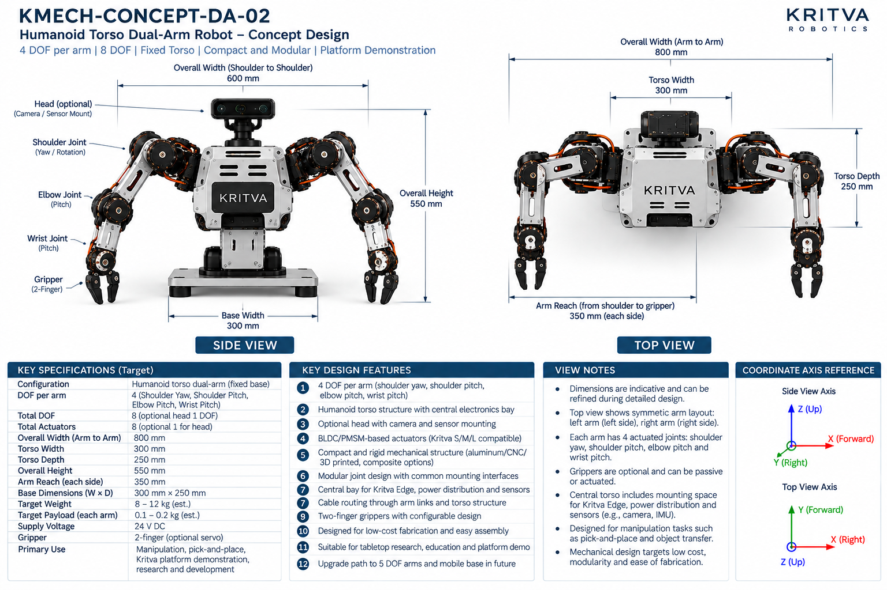
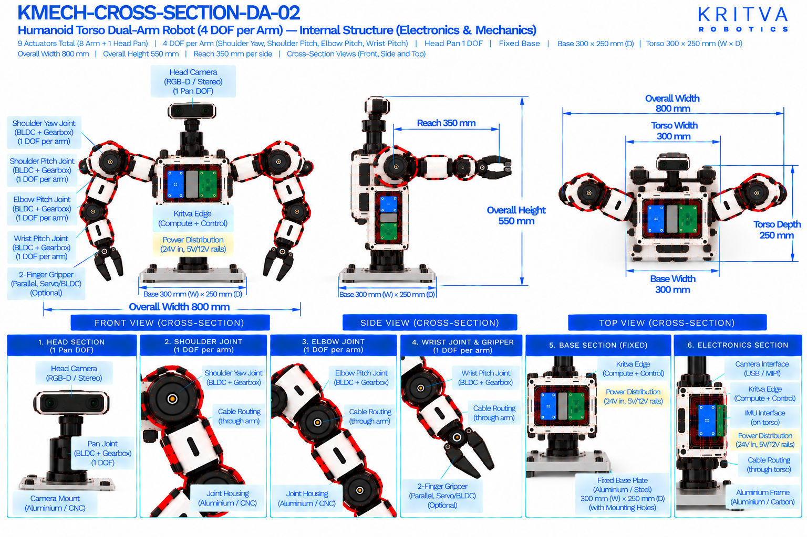

# DA-02 — Humanoid Torso Dual-Arm

| Property | Value |
|---|---|
| Document ID | KMECH-CONCEPT-DA-02 |
| Repository | `KritvaOS/kritva-mechanical` |
| Document Type | Concept Overview |
| Status | PROPOSED |
| Owner | Dinesh |
| Assigned Intern | INTERN-02 |
| Version | 0.3.1 |
| Last Updated | 2026-10-31 |
| Authority | Feasibility study; subject to owner review |
| Related Documents | `feasibility/STUDY_PLAN.md`, `feasibility/REQUIREMENTS_REGISTER.md`, `docs/images/ARTWORK_MANIFEST.json`, `REQUIREMENTS.md`, `ARCHITECTURE.md` |

## 1. Purpose and Scope

DA-02 puts two 4-DOF arms on a fixed humanoid torso with an optional head for camera and sensor mounting. It adds a second shoulder axis to the DA-01 arm and a taller torso, and is the medium-complexity step between a tabletop dual-arm and the mobile and 5-DOF concepts. This README records what the two artwork sheets print and what the intern must investigate; it does not approve any value.

- Concept ID: DA-02
- Concept name: Humanoid Torso Dual-Arm
- Family: Dual-arm
- Complexity: Medium (relative engineering category, not a validated assessment)
- Assigned intern: INTERN-02
- Assessment revision: none yet (NOT STARTED)

## 2. Reference Artwork

*Concept sheet: `docs/images/KMECH-CONCEPT-DA-02.png`. This is the primary configuration reference.*

*Cross-section sheet: `docs/images/KMECH-CROSS-SECTION-DA-02.png`. This is an illustrative internal arrangement.*

Both sheets are concept artwork (evidence type C, PROPOSED, maturity L0 as proposed in the planning discussion). They are not to scale, are not CAD, and are not engineering evidence. The earlier `.svg` sketch is superseded by these sheets.

## 3. Configuration

| Item | Value | Source |
|---|---|---|
| Robot type | Humanoid-torso dual-arm, fixed torso on a fixed base plate | Concept and Cross-section |
| Arms | 2 (left and right, symmetric) | Concept |
| DOF per arm | 4 (shoulder yaw, shoulder pitch, elbow pitch, wrist pitch) | Concept and Cross-section |
| Total DOF | 8 (optional head adds 1 DOF) | Concept |
| Head | Optional camera and sensor mount | Concept |
| Gripper | 2-finger; optional servo; may be passive | Concept and Cross-section |
| Base | Fixed base plate; no mobility | Concept and Cross-section |
| Future path | Upgrade path to 5-DOF arms and a mobile base is printed on the concept sheet as a design feature; it is not part of the study baseline | Concept |

## 4. CONCEPT_TARGET

Every value is printed on the artwork and is `CONCEPT_TARGET`: indicative, unapproved, and not a requirement. Requirements-register values stay `UNKNOWN` or `TBD` until the owner resolves them. Where the sheets disagree, both values are shown and marked `DISCREPANCY — OWNER REVIEW`; nothing is chosen by inference.

| Item | Value as printed | Source sheet | Status |
|---|---|---|---|
| Total actuators | 8 (optional 1 for head) | Concept | CONCEPT_TARGET |
| Overall width (arm to arm) | 800 mm | Concept and Cross-section | CONCEPT_TARGET |
| Overall width (shoulder to shoulder) | 600 mm | Concept | CONCEPT_TARGET |
| Torso width | 300 mm | Concept and Cross-section | CONCEPT_TARGET |
| Torso depth | 250 mm | Concept and Cross-section | CONCEPT_TARGET |
| Overall height | 550 mm | Concept and Cross-section | CONCEPT_TARGET |
| Base width | 300 mm | Concept and Cross-section | CONCEPT_TARGET |
| Base dimensions (W × D) | 300 mm × 250 mm | Concept and Cross-section | CONCEPT_TARGET |
| Arm reach (each side) | 350 mm (shoulder to gripper) | Concept | CONCEPT_TARGET |
| Target payload (each arm) | 0.1 – 0.2 kg (est.) | Concept | CONCEPT_TARGET |
| Target weight | 8 – 12 kg (est.) | Concept | CONCEPT_TARGET |
| Supply voltage | 24 V DC (concept-level power indication, not a confirmed electrical interface) | Concept | CONCEPT_TARGET |
| Power rails shown inside | 24 V in; 5 V and 12 V rails | Cross-section | CONCEPT_TARGET |
| Primary use | Manipulation, pick-and-place, Kritva platform demonstration, research and development | Concept | CONCEPT_TARGET |
All dimensions, DOF and actuator counts printed on both sheets agree after the cross-section sheets were regenerated on 2026-10-31. A value printed on one sheet only names that sheet. The concept sheet's own view notes say dimensions are indicative. Items not printed on either sheet (for example joint torque, speed, stride, battery capacity, camera models) stay TBD.

## 5. Mechanical Architecture

Subsystem-level description from the sheets. Materials and mechanisms are options shown on the artwork, not selections. There is no CAD.

| Element | What the artwork shows | Status |
|---|---|---|
| Base plate | Fixed mounting plate, aluminium or steel | Illustrative |
| Torso | Humanoid torso with a central electronics bay; the cross-section labels the torso frame as aluminium and shows front and side sections | Illustrative |
| Shoulders | Two joints per shoulder: yaw or rotation, then pitch; shoulder-to-shoulder spacing 600 mm on the concept sheet | Illustrative |
| Arm links | Aluminium, CNC machined or 3D printed; composite options named on the concept sheet | Illustrative |
| Joint assemblies | Joint housing (aluminium or CNC) with a BLDC/PMSM motor, a harmonic or planetary gearbox, an output shaft with an absolute or incremental encoder, and a timing belt where used; modular joints with common mounting interfaces | Illustrative |
| Grippers | Two-finger linkage on a gripper mount; optional servo or BLDC; optional force sensor; rubber or TPU finger pads | Illustrative |
| Head and camera | One-axis pan head (BLDC and gearbox) carrying an RGB-D or stereo camera on a neck mount in aluminium or CNC | Illustrative; optional, see D6 |

## 6. Joint and Actuator Mapping

Mapping as printed on the sheets. Motor model, torque, speed, gear ratio and S/M/L assignment are not given by any approved source and stay TBD.

| Joint or actuator | Intended motion or axis | DOF | Proposed technology (as shown) | Baseline or optional |
|---|---|---|---|---|
| Shoulder yaw (each arm) | Yaw / rotation | 1 | BLDC/PMSM with gearbox | Baseline |
| Shoulder pitch (each arm) | Pitch | 1 | BLDC/PMSM with gearbox | Baseline |
| Elbow (each arm) | Pitch | 1 | BLDC/PMSM with gearbox | Baseline |
| Wrist (each arm) | Pitch | 1 | BLDC/PMSM with gearbox | Baseline |
| Gripper (each arm) | Parallel two-finger open and close | 0 (counted separately) | Optional servo or BLDC, as shown | Optional |
| Head pan | Pan about the vertical axis | 1 (optional; baseline is 8 arm actuators, 9 when the head pan is fitted) | BLDC with gearbox (cross-section) | Optional; see D6 |

Count: 8 baseline arm actuators (4 DOF × 2 arms); the concept sheet adds 1 optional actuator for the head. The sheet does not give a gripper actuator count; gripper actuation is optional and its type and count are TBD. The concept sheet calls the actuators Kritva S/M/L compatible; this study has not mapped any joint to S, M or L. Joint axes are taken from the sheet labels, not inferred from rendered motor orientation.

## 7. Electronics and Power

Block-level placement and interfaces as shown on the sheets; there is no wiring schematic.

| Block | What the artwork shows | Status |
|---|---|---|
| Kritva Edge (compute and control) | Board in the torso electronics enclosure | Illustrative; board dimensions TBD |
| Power distribution board | Inside the enclosure; 24 V input with 5 V and 12 V rails | Illustrative; electrical requirements TBD |
| Motor drivers | Left-arm and right-arm driver stacks inside the torso | Illustrative; driver selection TBD |
| Camera interface | USB / MIPI camera interface in the torso section | Illustrative; interface list TBD |
| Sensors | Head camera (RGB-D or stereo) and an IMU on the torso (cross-section); IMU mounting space is mentioned on the concept sheet | Optional; sensor selection TBD |

## 8. Cable Routing and Serviceability

Routes as labelled on the cross-section sheet. No harness design is implied.

- Left-arm and right-arm cables pass through the shoulders.
- Cables run through the arm links to the wrist and gripper.
- Cable routing runs through the torso, and through the neck to the head camera.
- Concern to investigate: four joints per arm with two at the shoulder make cable bend, twist and pinch more severe than DA-01; the head pan joint adds a rotating cable path.

## 9. Risks and Unknowns

1. Open items D5 and D6 (shoulder spacing, head DOF counting) leave head and torso packaging UNKNOWN until the owner decides.
2. Torso packaging: space for Kritva Edge, drivers, power distribution and an optional fan inside a 300 mm × 250 mm torso is not assessed.
3. Four-DOF shoulder arrangement: how the yaw and pitch axes intersect or offset, and the resulting workspace and singularities, are UNKNOWN.
4. Stability and base loading with 8 – 12 kg (est.) mass on a fixed base plate: not calculated.
5. Actuator sizing: torque and speed per joint are not derived; S/M/L compatibility is unassessed.
6. Cable routing through eight arm joints and an adjustable mast: UNKNOWN.
7. Printed weight and payload targets have no stated basis.

## 10. Artwork Discrepancies

| ID | Discrepancy | Sheets | Status |
|---|---|---|---|
| D1 | Overall height: 550 mm (concept) vs 600 mm (cross-section) | Both | RESOLVED (cross-section regenerated 2026-10-31); both print 550 mm |
| D2 | Base width: 300 mm (concept) vs 400 mm (cross-section) | Both | RESOLVED (cross-section regenerated 2026-10-31); both print 300 mm |
| D3 | Camera arrangement: single-camera head (concept) vs three-camera mast (cross-section) | Both | RESOLVED (cross-section regenerated 2026-10-31); cross-section now shows a head camera |
| D4 | Head motion: one optional head DOF (concept) vs pan/tilt mount (cross-section) | Both | RESOLVED (cross-section regenerated 2026-10-31); cross-section now shows a one-axis pan |
| D5 | Shoulder-to-shoulder width is 600 mm on the concept sheet only | Concept | NOT VERIFIABLE FROM CURRENT ARTWORK |
| D6 | Actuator count: the concept counts 8 arm actuators plus 1 optional head actuator; the cross-section prints '9 Actuators Total' with the head counted | Both | RESOLVED (owner decision 2026-10-31): baseline is 8 arm actuators; the optional head pan adds 1, giving 9 when fitted. The cross-section's 9 is the head-fitted configuration |

The two sheets now agree on width 800 mm, height 550 mm, torso 300 mm × 250 mm, base 300 mm × 250 mm, reach 350 mm, 4 DOF per arm and a one-axis head. Review status: concept sheet `REVIEWED`, cross-section `REVIEWED` in `docs/images/ARTWORK_MANIFEST.json`. REVIEWED is not design approval.

## 11. Feasibility Activity and Evidence

What the assigned intern investigates, using paper methods only (calculations, comparison tables, sketches and cited datasheets):

- [ ] Settle the height and base width the study uses, then sketch the torso layout with Kritva Edge, drivers and power distribution to check the space (evidence C)
- [ ] Draw the four-axis arm kinematic sketch with joint axes and coordinate frames, and estimate workspace and the overlap of the two arms (evidence C)
- [ ] Derive static torque at each of the four joints for a stated payload and pose, then compare with S/M/L data once the owner supplies it (evidence C)
- [ ] Check base loading and tipping margin for the extended-arm case (evidence C)
- [ ] Estimate mass by subsystem with stated assumptions, separately from the printed 8 – 12 kg (evidence C)
- [ ] List the cable path through each shoulder, joint and the mast, with bend and twist concerns (evidence C)
- [ ] Record intern-generated cost assumptions separately from printed targets; no quotation or procurement

## 12. Revision and Traceability

| Item | Value |
|---|---|
| README revision | 0.3.1 |
| Concept sheet | `docs/images/KMECH-CONCEPT-DA-02.png` |
| Cross-section sheet | `docs/images/KMECH-CROSS-SECTION-DA-02.png` |
| Manifest | `docs/images/ARTWORK_MANIFEST.json` |
| Review state | Artwork audited by Claude (round 6, 2026-10-31); owner confirmation pending. This README records what the artwork prints and does not approve any value |

## 13. Folder Contents

This README and the two artwork sheets exist today. The files and folders below are created by the assigned intern as work progresses, using `feasibility/templates/`. There is no `cad/` folder while HOLD D-003 is active.

- `REQUIREMENTS.md`
- `ARCHITECTURE.md`
- `MECHANICAL_ANALYSIS.md`
- `ACTUATOR_ANALYSIS.md`
- `INTERFACES.md`
- `MASS_BUDGET.md`
- `COST_MODEL.md`
- `OPEN_QUESTIONS.md`
- `calculations/`
- `references/`
- `reviews/`
- `sketches/`

## 14. Current Assessment

- Overall status: NOT STARTED (README expanded from the artwork on 2026-10-31; no feasibility assessment has been performed)
- Requirements completeness: TBD
- Architecture assessment: TBD
- Engineering assessment: TBD
- Actuator compatibility: TBD
- Cost assessment: TBD
- Major risks: TBD
- Evidence gaps: TBD

## 15. Checkpoint Progress

| Checkpoint | Status | Review reference |
|---|---|---|
| CP2 | TBD | `reviews/` |
| CP3 | TBD | `reviews/` |
| CP4 | TBD | `reviews/` |

## 16. Open Decisions

1. Whether the optional head pan is fitted in the study configuration (D6 is settled: 8 baseline, 9 when fitted).
2. Whether grippers are powered in the baseline configuration (currently optional).
3. Payload, reach and mass targets remain `UNKNOWN` in the requirements register until resolved.
4. Joint to S/M/L actuator mapping is not started.

## 17. HOLD D-003

Paper feasibility work only. CAD, final BOM, quotations, procurement, fabrication, assembly and physical testing remain NOT STARTED and require explicit owner decision. This template does not authorize implementation.
