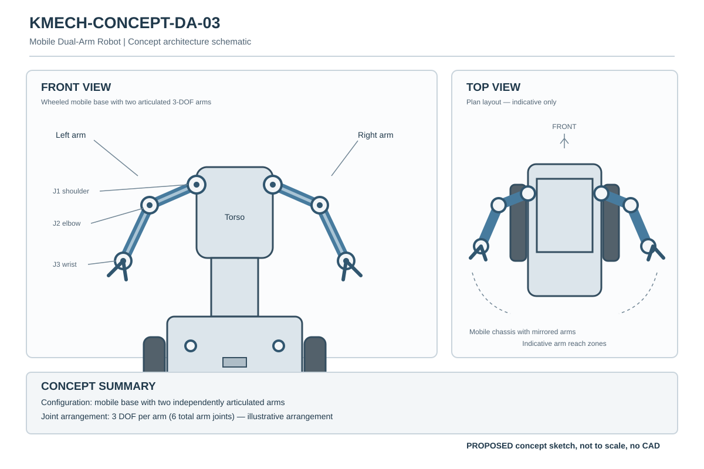

# DA-03 — Mobile Dual-Arm

| Property | Value |
|---|---|
| Document ID | KMECH-CONCEPT-DA-03 |
| Repository | `KritvaOS/kritva-mechanical` |
| Document Type | Concept Overview |
| Status | PROPOSED |
| Owner | Dinesh |
| Assigned Intern | INTERN-02 |
| Version | 0.1.0 |
| Last Updated | 2026-10-30 |
| Authority | Feasibility study; subject to owner review |
| Related Documents | `feasibility/STUDY_PLAN.md`, `REQUIREMENTS.md`, `ARCHITECTURE.md` |

## 1. Concept Identification

- Concept ID: DA-03
- Concept name: Mobile Dual-Arm
- Family: Dual-arm
- Complexity: High
- Assigned intern: INTERN-02
- Assessment revision: none yet (NOT STARTED)

## 2. Concept Summary

- Intended configuration: Mobile base, two 3-DOF arms (preliminary study definition)
- Primary demonstration objective: Kritva platform demonstration
- Key capabilities: TBD
- Major assumptions: TBD
- Known limitations: TBD

### Concept sketch

Illustrative schematic only (evidence type C, PROPOSED). It is not to scale, is not CAD, and carries no engineering evidence. Source file: `docs/images/KMECH-CONCEPT-DA-03.svg`.

## 3. Folder Contents

Only this README exists today. The files and folders below are created by the assigned intern as work progresses, using `feasibility/templates/`. There is no `cad/` folder while HOLD D-003 is active.

- `REQUIREMENTS.md`
- `ARCHITECTURE.md`
- `MECHANICAL_ANALYSIS.md`
- `ACTUATOR_ANALYSIS.md`
- `INTERFACES.md`
- `MASS_BUDGET.md`
- `COST_MODEL.md`
- `OPEN_QUESTIONS.md`
- `calculations/`
- `references/`
- `reviews/`
- `sketches/`

## 4. Current Assessment

- Overall status: NOT STARTED (stub created 2026-10-30)
- Requirements completeness: TBD
- Architecture assessment: TBD
- Engineering assessment: TBD
- Actuator compatibility: TBD
- Cost assessment: TBD
- Major risks: TBD
- Evidence gaps: TBD

## 5. Checkpoint Progress

| Checkpoint | Status | Review reference |
|---|---|---|
| CP2 | TBD | `reviews/` |
| CP3 | TBD | `reviews/` |
| CP4 | TBD | `reviews/` |

## 6. Open Decisions

List unresolved requirements, assumptions, dependencies and owner decisions. Use `TBD`, `UNKNOWN`, `BLOCKED` or `INCOMPLETE` as appropriate.

## 7. HOLD D-003

Paper feasibility work only. CAD, final BOM, quotations, procurement, fabrication, assembly and physical testing remain NOT STARTED and require explicit owner decision. This template does not authorize implementation.
