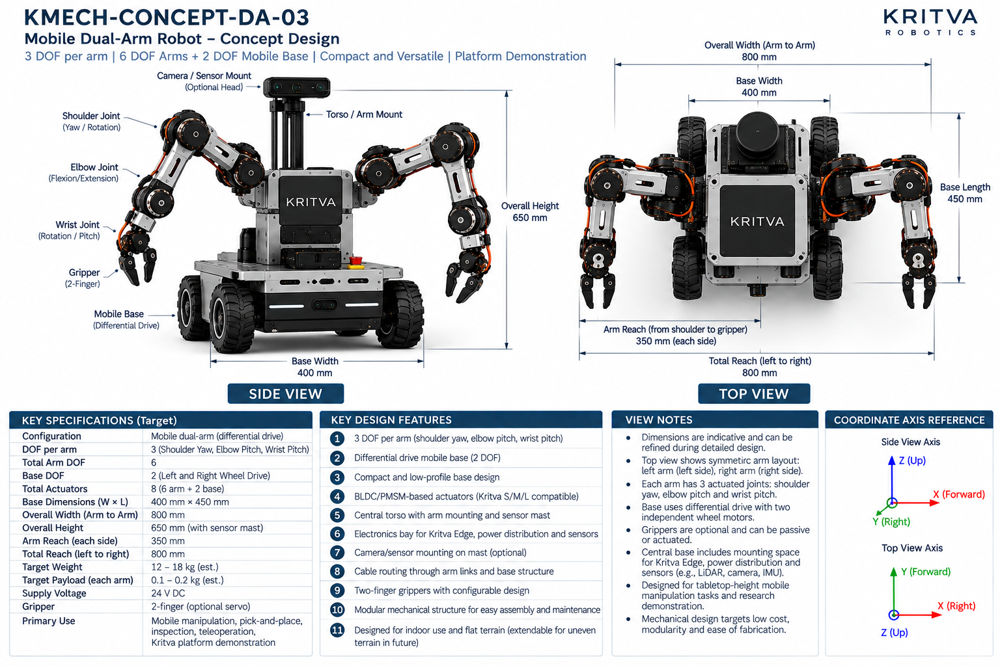
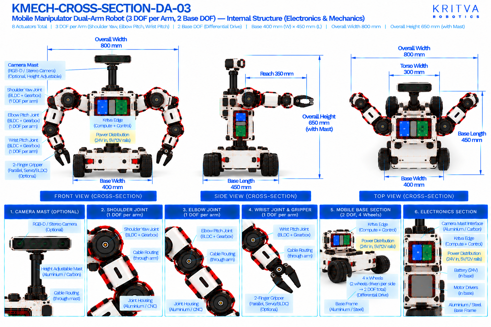

# DA-03 — Mobile Dual-Arm

| Property | Value |
|---|---|
| Document ID | KMECH-CONCEPT-DA-03 |
| Repository | `KritvaOS/kritva-mechanical` |
| Document Type | Concept Overview |
| Status | PROPOSED |
| Owner | Dinesh |
| Assigned Intern | INTERN-02 |
| Version | 0.3.0 |
| Last Updated | 2026-10-31 |
| Authority | Feasibility study; subject to owner review |
| Related Documents | `feasibility/STUDY_PLAN.md`, `feasibility/REQUIREMENTS_REGISTER.md`, `docs/images/ARTWORK_MANIFEST.json`, `REQUIREMENTS.md`, `ARCHITECTURE.md` |

## 1. Purpose and Scope

It adds mobility, battery power and base drive to the dual-arm family and is the high-complexity dual-arm concept in the study. The artwork presents it as a compact platform demonstration for tabletop-height mobile manipulation. This README records what the two artwork sheets print and what the intern must investigate; it does not approve any value.

- Concept ID: DA-03
- Concept name: Mobile Dual-Arm
- Family: Dual-arm
- Complexity: High (relative engineering category, not a validated assessment)
- Assigned intern: INTERN-02
- Assessment revision: none yet (NOT STARTED)

## 2. Reference Artwork

*Concept sheet: `docs/images/KMECH-CONCEPT-DA-03.png`. This is the primary configuration reference.*

*Cross-section sheet: `docs/images/KMECH-CROSS-SECTION-DA-03.png`. This is an illustrative internal arrangement.*

Both sheets are concept artwork (evidence type C, PROPOSED, maturity L0 as proposed in the planning discussion). They are not to scale, are not CAD, and are not engineering evidence. The earlier `.svg` sketch is superseded by these sheets.

## 3. Configuration

| Item | Value | Source |
|---|---|---|
| Robot type | Mobile dual-arm, differential-drive base with fixed torso | Concept and Cross-section |
| Arms | 2 (left and right, symmetric) | Concept and Cross-section |
| DOF per arm | 3 (shoulder yaw, elbow pitch, wrist pitch) | Concept and Cross-section |
| Arm DOF | 6 | Concept and Cross-section |
| Base DOF | 2 (left and right wheel drive) | Concept and Cross-section |
| Total DOF / actuators | 8 (6 arm + 2 base) | Concept and Cross-section |
| Gripper | 2-finger; optional servo or BLDC; may be passive | Concept and Cross-section |
| Head / sensors | Optional camera and sensor mount on a mast (RGB-D or stereo) | Concept and Cross-section |
| Environment | Indoor, flat terrain; extendable to uneven terrain in future (concept sheet) | Concept |

## 4. CONCEPT_TARGET

Every value is printed on the artwork and is `CONCEPT_TARGET`: indicative, unapproved, and not a requirement. Requirements-register values stay `UNKNOWN` or `TBD` until the owner resolves them. Where the sheets disagree, both values are shown and marked `DISCREPANCY — OWNER REVIEW`; nothing is chosen by inference.

| Item | Value as printed | Source sheet | Status |
|---|---|---|---|
| Total actuators | 8 (6 arm + 2 base); grippers not counted | Concept | CONCEPT_TARGET |
| Overall width (arm to arm) | 800 mm | Concept and Cross-section | CONCEPT_TARGET |
| Total reach (left to right) | 800 mm | Concept | CONCEPT_TARGET |
| Base dimensions (W × L) | 400 mm × 450 mm | Concept and Cross-section | CONCEPT_TARGET |
| Overall height | 650 mm (with sensor mast) | Concept and Cross-section | CONCEPT_TARGET |
| Arm reach (each side) | 350 mm (shoulder to gripper) | Concept | CONCEPT_TARGET |
| Target payload (each arm) | 0.1 – 0.2 kg (est.) | Concept | CONCEPT_TARGET |
| Target weight | 12 – 18 kg (est.) | Concept | CONCEPT_TARGET |
| Supply voltage | 24 V DC (concept-level power indication, not a confirmed electrical interface) | Concept and Cross-section | CONCEPT_TARGET |
| Battery | 24 V Li-ion pack (capacity not stated) | Cross-section | CONCEPT_TARGET |
| Power rails shown inside | 24 V in; 5 V and 12 V rails | Cross-section | CONCEPT_TARGET |
| Primary use | Mobile manipulation, pick-and-place, inspection, teleoperation, Kritva platform demonstration | Concept | CONCEPT_TARGET |
| Torso width | 300 mm | Cross-section | CONCEPT_TARGET; not printed on the concept sheet — OWNER REVIEW |
All dimensions, DOF and actuator counts printed on both sheets agree after the cross-section sheets were regenerated on 2026-10-31. A value printed on one sheet only names that sheet. The concept sheet's own view notes say dimensions are indicative. Items not printed on either sheet (for example joint torque, speed, stride, battery capacity, camera models) stay TBD.

## 5. Mechanical Architecture

Subsystem-level description from the sheets. Materials and mechanisms are options shown on the artwork, not selections. There is no CAD.

| Element | What the artwork shows | Status |
|---|---|---|
| Mobile base | Differential-drive chassis with four drive wheels (left pair and right pair), one drive motor per wheel, 2 DOF in total; aluminium or steel base frame | Illustrative |
| Wheel drive | BLDC motor with encoder per driven wheel, optional gearbox, wheel hub and rubber tyre | Illustrative |
| Torso / arm mount | Fixed central torso carrying both arms and the electronics enclosure | Illustrative |
| Arms | Aluminium or 3D-printed links, three joints per arm; cables routed through the shoulder and links | Illustrative |
| Joint assemblies | Joint housing (aluminium or CNC) with a BLDC/PMSM motor, a harmonic or planetary gearbox and an output shaft with an absolute or incremental encoder | Illustrative |
| Grippers | Two-finger linkage on a gripper mount; optional servo or BLDC; optional force sensor; rubber or TPU finger pads | Illustrative |
| Sensor mast | Mast on the torso carrying an optional RGB-D or stereo camera; the cross-section labels it height adjustable | Optional |
| Battery bay | 24 V Li-ion pack in the base between the wheel drives | Illustrative; capacity TBD |

## 6. Joint and Actuator Mapping

Mapping as printed on the sheets. Motor model, torque, speed, gear ratio and S/M/L assignment are not given by any approved source and stay TBD.

| Joint or actuator | Intended motion or axis | DOF | Proposed technology (as shown) | Baseline or optional |
|---|---|---|---|---|
| Shoulder (each arm) | Yaw / rotation | 1 | BLDC/PMSM with gearbox | Baseline |
| Elbow (each arm) | Pitch (flexion / extension) | 1 | BLDC/PMSM with gearbox | Baseline |
| Wrist (each arm) | Pitch (concept sheet label: rotation / pitch; see D3) | 1 | BLDC/PMSM with gearbox | Baseline |
| Left wheel | Drive (rotation) | 1 | BLDC with encoder, optional gearbox | Baseline |
| Right wheel | Drive (rotation) | 1 | BLDC with encoder, optional gearbox | Baseline |
| Gripper (each arm) | Parallel two-finger open and close | 0 (counted separately) | Optional servo or BLDC, as shown | Optional |

Count: 6 arm actuators (3 DOF × 2 arms) plus 2 base actuators = 8, as the concept sheet states. Gripper actuation is optional and not counted; its type and count are TBD. The concept sheet calls the actuators Kritva S/M/L compatible; this study has not mapped any joint to S, M or L. Joint axes are taken from the sheet labels, not inferred from rendered motor orientation.

## 7. Electronics and Power

Block-level placement and interfaces as shown on the sheets; there is no wiring schematic.

| Block | What the artwork shows | Status |
|---|---|---|
| Kritva Edge (compute and control) | Board in the torso electronics enclosure | Illustrative; board dimensions TBD |
| Power distribution board | 24 V in with 5 V and 12 V rails | Illustrative; electrical requirements TBD |
| Motor drivers | Left wheel driver and right wheel driver in the base; arm drivers in the torso enclosure | Illustrative; driver selection TBD |
| Battery | 24 V Li-ion pack in the base | Illustrative; capacity, protection and charging TBD |
| Sensors | Optional RGB-D or stereo camera on the mast; the concept sheet also mentions space for LiDAR, camera and IMU (LiDAR is not drawn on the current cross-section) | Optional; sensor selection TBD |
| Emergency stop | A red button is visible on the concept side-view render but is not labelled or listed on either sheet | Author observation; safety design TBD |

## 8. Cable Routing and Serviceability

Routes as labelled on the cross-section sheet. No harness design is implied.

- Left-arm and right-arm cables pass through the shoulders.
- Cables run through the arm links to the wrist and gripper.
- Power and signal run from the battery and electronics enclosure to the wheel drives and to the arms; the concept sheet says cabling runs through the arm links and base structure.
- Concern to investigate: the base is a moving platform, so cable strain relief, connector retention and vibration must be considered along the whole path; this is not designed here.

## 9. Risks and Unknowns

1. Four-wheel layout with paired drive: scrub in turns, turning behaviour and stability are UNKNOWN and not assessed.
2. Stability and tipping: a 650 mm tall robot of 12 – 18 kg (est.) with arms extended on a 400 mm × 450 mm base is not calculated, and extended-arm payload shifts the centre of gravity.
3. Battery sizing, runtime, protection and charging are not specified; 24 V Li-ion pack capacity is TBD. No battery safety assessment is made in this study.
4. Actuator sizing: arm torque and wheel drive torque are not derived; S/M/L compatibility is unassessed.
5. Packaging: space for battery, two wheel drivers, Kritva Edge and arm drivers within the base and torso is not assessed.
6. Only three DOF per arm: orientation capability is limited, so which tabletop tasks are reachable is UNKNOWN.
7. Printed weight, payload and reach targets have no stated basis.

## 10. Artwork Discrepancies

| ID | Discrepancy | Sheets | Status |
|---|---|---|---|
| D1 | No dimension or DOF disagrees between the two sheets; overall width, base size, height, 6 arm DOF and 2 base DOF match | Both | NONE FOUND |
| D2 | Wheel arrangement: 2 DOF differential drive versus four wheels drawn | Both | RESOLVED (cross-section regenerated 2026-10-31); both sheets show four wheels as a left pair and a right pair, 2 DOF in total |
| D3 | Wrist terminology: the concept labels the wrist rotation / pitch while its specification and the cross-section state wrist pitch; one DOF per wrist is counted on both | Both | OPEN |
| D4 | LiDAR is mentioned on the concept sheet and is not drawn on the cross-section | Both | OPEN |
| D5 | Reach and width: the sheets print 350 mm reach each side and 800 mm overall width and total reach, but do not state the shoulder spacing or whether the arms are drawn fully extended, so the three figures cannot be reconciled from the artwork | Concept | NOT VERIFIABLE FROM CURRENT ARTWORK |
| D6 | Torso width 300 mm and a height-adjustable mast are on the cross-section only | Cross-section | OPEN — OWNER REVIEW |

Both sheets agree on width 800 mm, height 650 mm with mast, base 400 mm × 450 mm, reach 350 mm, 3 DOF per arm, 2 base DOF, 8 actuators and a four-wheel differential drive. Review status: concept sheet `REVIEWED_WITH_ISSUES` (D3, D4), cross-section `REVIEWED_WITH_ISSUES` (D6) in `docs/images/ARTWORK_MANIFEST.json`. REVIEWED is not design approval.

## 11. Feasibility Activity and Evidence

What the assigned intern investigates, using paper methods only (calculations, comparison tables, sketches and cited datasheets):

- [ ] Decide with the owner whether the base is two driven wheels with a caster or a four-wheel layout, then sketch the drive arrangement and turning behaviour (evidence C)
- [ ] Draw the three-axis arm kinematic sketch with joint axes and coordinate frames, and estimate the reachable workspace from the base (evidence C)
- [ ] Calculate static tipping margin for the extended-arm case with a stated payload and mass (evidence C)
- [ ] Derive static torque at the arm joints and a drive torque estimate for the wheels on a stated slope and mass; compare with S/M/L data once the owner supplies it (evidence C)
- [ ] Estimate energy use and battery capacity against a stated runtime, as a paper calculation with assumptions listed (evidence C)
- [ ] Sketch the base layout for battery, drivers and Kritva Edge, with cable paths for a moving base (evidence C)
- [ ] Record intern-generated cost assumptions separately from printed targets; no quotation or procurement

## 12. Revision and Traceability

| Item | Value |
|---|---|
| README revision | 0.3.0 |
| Concept sheet | `docs/images/KMECH-CONCEPT-DA-03.png` |
| Cross-section sheet | `docs/images/KMECH-CROSS-SECTION-DA-03.png` |
| Manifest | `docs/images/ARTWORK_MANIFEST.json` |
| Review state | Artwork audited by Claude (round 6, 2026-10-31); owner confirmation pending. This README records what the artwork prints and does not approve any value |

## 13. Folder Contents

This README and the two artwork sheets exist today. The files and folders below are created by the assigned intern as work progresses, using `feasibility/templates/`. There is no `cad/` folder while HOLD D-003 is active.

- `REQUIREMENTS.md`
- `ARCHITECTURE.md`
- `MECHANICAL_ANALYSIS.md`
- `ACTUATOR_ANALYSIS.md`
- `INTERFACES.md`
- `MASS_BUDGET.md`
- `COST_MODEL.md`
- `OPEN_QUESTIONS.md`
- `calculations/`
- `references/`
- `reviews/`
- `sketches/`

## 14. Current Assessment

- Overall status: NOT STARTED (README expanded from the artwork on 2026-10-31; no feasibility assessment has been performed)
- Requirements completeness: TBD
- Architecture assessment: TBD
- Engineering assessment: TBD
- Actuator compatibility: TBD
- Cost assessment: TBD
- Major risks: TBD
- Evidence gaps: TBD

## 15. Checkpoint Progress

| Checkpoint | Status | Review reference |
|---|---|---|
| CP2 | TBD | `reviews/` |
| CP3 | TBD | `reviews/` |
| CP4 | TBD | `reviews/` |

## 16. Open Decisions

1. Whether LiDAR is part of the baseline sensor set (D4); the owner decides.
2. Whether the torso width and the height-adjustable mast on the cross-section are kept (D6).
3. Whether grippers are powered in the baseline configuration (currently optional).
4. Payload, reach, weight and runtime targets remain `UNKNOWN` in the requirements register until resolved.
5. Joint to S/M/L actuator mapping is not started.

## 17. HOLD D-003

Paper feasibility work only. CAD, final BOM, quotations, procurement, fabrication, assembly and physical testing remain NOT STARTED and require explicit owner decision. This template does not authorize implementation.
