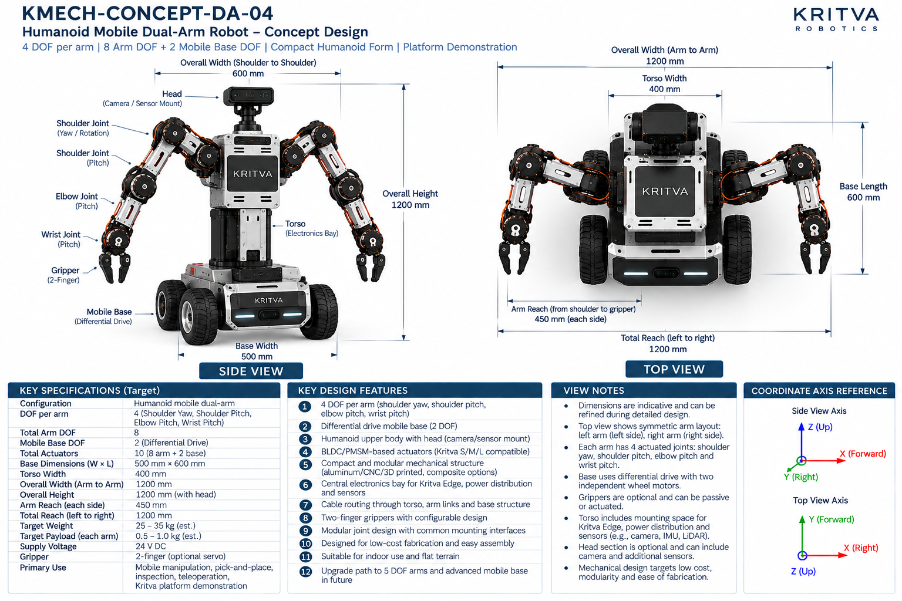
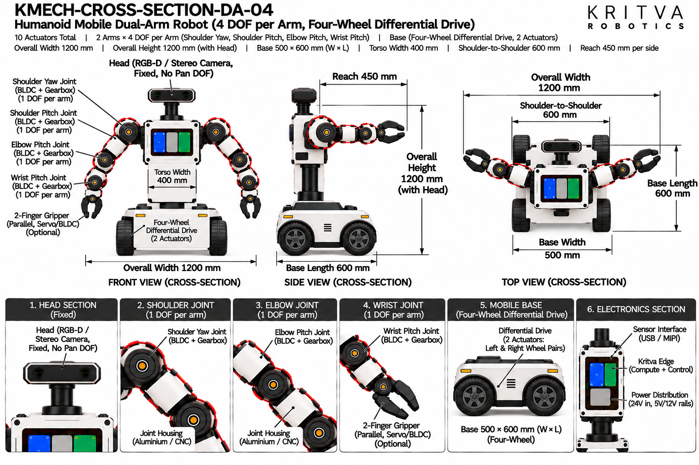

# DA-04 — Advanced Dual-Arm

| Property | Value |
|---|---|
| Document ID | KMECH-CONCEPT-DA-04 |
| Repository | `KritvaOS/kritva-mechanical` |
| Document Type | Concept Overview |
| Status | PROPOSED |
| Owner | Dinesh |
| Assigned Intern | INTERN-01 |
| Version | 0.3.1 |
| Last Updated | 2026-10-31 |
| Authority | Feasibility study; subject to owner review |
| Related Documents | `feasibility/STUDY_PLAN.md`, `feasibility/REQUIREMENTS_REGISTER.md`, `docs/images/ARTWORK_MANIFEST.json`, `REQUIREMENTS.md`, `ARCHITECTURE.md` |

## 1. Purpose and Scope

It is the largest and heaviest dual-arm concept in the study. It supersedes the earlier one-line study-plan definition of DA-04 (two 5-DOF arms); the owner approved the 4-DOF definition as the study baseline on 2026-10-31.

- Concept ID: DA-04
- Concept name: Humanoid Mobile Dual-Arm
- Family: Dual-arm
- Complexity: High (relative engineering category, not a validated assessment)
- Assigned intern: INTERN-01
- Assessment revision: none yet (NOT STARTED)

## 2. Reference Artwork

*Concept sheet: `docs/images/KMECH-CONCEPT-DA-04.png`. This is the primary configuration reference.*

*Cross-section sheet: `docs/images/KMECH-CROSS-SECTION-DA-04.png`. This is an illustrative internal arrangement.*

Both sheets are concept artwork (evidence type C, PROPOSED, maturity L0 as proposed in the planning discussion). They are not to scale, are not CAD, and are not engineering evidence. The earlier `.svg` sketch is superseded by these sheets.

## 3. Configuration

| Item | Value | Source |
|---|---|---|
| Robot type | Humanoid mobile dual-arm: fixed torso with head on a differential-drive base | Concept and Cross-section |
| Arms | 2 (left and right, symmetric) | Concept and Cross-section |
| DOF per arm | 4 (shoulder yaw, shoulder pitch, elbow pitch, wrist pitch) | Concept and Cross-section |
| Arm DOF | 8 | Concept and Cross-section |
| Base DOF | 2 (differential drive, one drive channel per side) | Concept and Cross-section |
| Total DOF / actuators | 10 (8 arm + 2 base); grippers not counted | Concept and Cross-section |
| Gripper | 2-finger; optional servo or BLDC; may be passive | Concept and Cross-section |
| Head / sensors | Head with an RGB-D or stereo camera on a camera mount; the cross-section shows a 1 DOF pan not counted in the 10 actuators | Concept and Cross-section |
| Future path | Upgrade path to 5-DOF arms and an advanced mobile base is printed on the concept sheet as a design feature; it is not part of the study baseline | Concept |

## 4. CONCEPT_TARGET

Every value is printed on the artwork and is `CONCEPT_TARGET`: indicative, unapproved, and not a requirement. Requirements-register values stay `UNKNOWN` or `TBD` until the owner resolves them. Where the sheets disagree, both values are shown and marked `DISCREPANCY — OWNER REVIEW`; nothing is chosen by inference.

| Item | Value as printed | Source sheet | Status |
|---|---|---|---|
| Total actuators | 10 (8 arm + 2 base) | Concept | CONCEPT_TARGET |
| Overall width (arm to arm) | 1200 mm | Concept and Cross-section | CONCEPT_TARGET |
| Overall width (shoulder to shoulder) | 600 mm | Concept | CONCEPT_TARGET |
| Total reach (left to right) | 1200 mm | Concept | CONCEPT_TARGET |
| Torso width | 400 mm | Concept | CONCEPT_TARGET |
| Base dimensions (W × L) | 500 mm × 600 mm | Concept and Cross-section | CONCEPT_TARGET |
| Overall height | 1200 mm (with head) | Concept and Cross-section | CONCEPT_TARGET |
| Arm reach (each side) | 450 mm (shoulder to gripper) | Concept | CONCEPT_TARGET |
| Target payload (each arm) | 0.5 – 1.0 kg (est.) | Concept | CONCEPT_TARGET |
| Target weight | 25 – 35 kg (est.) | Concept | CONCEPT_TARGET |
| Supply voltage | 24 V DC (concept-level power indication, not a confirmed electrical interface) | Concept and Cross-section | CONCEPT_TARGET |
| Battery | 24 V Li-ion pack (capacity not stated) | Cross-section | CONCEPT_TARGET |
| Power rails shown inside | 24 V in; 5 V and 12 V rails | Cross-section | CONCEPT_TARGET |
| Primary use | Mobile manipulation, pick-and-place, inspection, teleoperation, Kritva platform demonstration | Concept | CONCEPT_TARGET |
All dimensions, DOF and actuator counts printed on both sheets agree after the cross-section sheets were regenerated on 2026-10-31. A value printed on one sheet only names that sheet. The concept sheet's own view notes say dimensions are indicative. Items not printed on either sheet (for example joint torque, speed, stride, battery capacity, camera models) stay TBD.

## 5. Mechanical Architecture

Subsystem-level description from the sheets. Materials and mechanisms are options shown on the artwork, not selections. There is no CAD.

| Element | What the artwork shows | Status |
|---|---|---|
| Mobile base | Differential-drive chassis with four drive wheels (left pair and right pair), two driven channels (one per side, each driving a wheel pair), 2 DOF in total; battery in the base | Illustrative |
| Wheel drive | BLDC motor with encoder per side, optional gearbox, wheel hub and rubber tyre | Illustrative |
| Torso | Humanoid upper body; electronics bay with Kritva Edge and power distribution; torso frame in aluminium or carbon; cable routing through the torso | Illustrative |
| Shoulders | Two joints per shoulder: yaw or rotation, then pitch; 600 mm shoulder spacing on the concept sheet | Illustrative |
| Arm links | Aluminium, CNC machined or 3D printed; composite options named on the concept sheet | Illustrative |
| Joint assemblies | Joint housing (aluminium or CNC) with a BLDC/PMSM motor, a harmonic or planetary gearbox, an output shaft with an absolute or incremental encoder, and a timing belt where used | Illustrative |
| Grippers | Two-finger linkage on a gripper mount; optional servo or BLDC; optional force sensor; rubber or TPU finger pads | Illustrative |
| Head | Head with a camera on a camera mount; pan axis shown on the cross-section | Illustrative; see D8 |

## 6. Joint and Actuator Mapping

Mapping as printed on the sheets. Motor model, torque, speed, gear ratio and S/M/L assignment are not given by any approved source and stay TBD.

| Joint or actuator | Intended motion or axis | DOF | Proposed technology (as shown) | Baseline or optional |
|---|---|---|---|---|
| Shoulder yaw (each arm) | Yaw / rotation | 1 | BLDC/PMSM with gearbox | Baseline |
| Shoulder pitch (each arm) | Pitch | 1 | BLDC/PMSM with gearbox | Baseline |
| Elbow (each arm) | Pitch | 1 | BLDC/PMSM with gearbox | Baseline |
| Wrist (each arm) | Pitch | 1 | BLDC/PMSM with gearbox | Baseline |
| Left wheel pair | Drive (rotation) | 1 | BLDC with encoder (cross-section labels DC BLDC), optional gearbox | Baseline |
| Right wheel pair | Drive (rotation) | 1 | BLDC with encoder, optional gearbox | Baseline |
| Gripper (each arm) | Parallel two-finger open and close | 0 (counted separately) | Optional servo or BLDC, as shown | Optional |
| Head pan | Pan about the vertical axis | 0 (not counted in the 10 actuators) | Not stated | Excluded from the baseline unless approved; see D8 |

Count: 8 arm actuators (4 DOF × 2 arms) plus 2 base actuators = 10, as both sheets state. Gripper actuation is optional and not counted; its type and count are TBD. The head is not counted as a DOF on either sheet. The concept sheet calls the actuators Kritva S/M/L compatible; this study has not mapped any joint to S, M or L. Joint axes are taken from the sheet labels, not inferred from rendered motor orientation.

## 7. Electronics and Power

Block-level placement and interfaces as shown on the sheets; there is no wiring schematic.

| Block | What the artwork shows | Status |
|---|---|---|
| Kritva Edge (compute and control) | Board in the torso electronics enclosure | Illustrative; board dimensions TBD |
| Power distribution board | 24 V in with 5 V and 12 V rails | Illustrative; electrical requirements TBD |
| Motor drivers | Arm motor drivers (left and right) in the torso; base drivers (left-side and right-side drive) in the base | Illustrative; driver selection TBD |
| Battery | 24 V Li-ion pack in the base | Illustrative; capacity, protection and charging TBD |
| I/O interfaces | Ethernet, USB and GPIO are labelled in the torso section | Illustrative; interface list TBD |
| Sensors | Head camera (RGB-D or stereo) and an IMU on the torso (cross-section); camera, IMU and LiDAR space mentioned on the concept sheet | Optional; sensor selection TBD |

## 8. Cable Routing and Serviceability

Routes as labelled on the cross-section sheet. No harness design is implied.

- Left-arm and right-arm cables pass through the shoulders.
- Cables run through the arm links to the wrist and gripper.
- Cable routing runs through the torso to the base.
- Concern to investigate: the torso-to-base path is a cable crossing point on a moving base; strain relief and connector retention are not designed here.
- Concern to investigate: eight arm joints with two at each shoulder plus a moving base compound bend, twist and strain problems.

## 9. Risks and Unknowns

1. Overall size is the concept sheet's 1200 mm × 1200 mm; the head pan (D8) is excluded from the baseline and the cross-section label is to be corrected, so the baseline count is 10.
2. Stability and tipping: 25 – 35 kg (est.) with arms reaching 450 mm each side on the base is not calculated; the concept's tall 1200 mm profile raises the tipping risk and the cross-section's 650 mm profile would change it.
3. Actuator sizing: shoulder torque at 0.5 – 1.0 kg (est.) payload and 450 mm reach is much higher than for DA-01 to DA-03; no calculation exists.
4. Battery sizing, runtime, protection and charging are not specified. No battery safety assessment is made in this study.
5. Packaging inside the torso and base is not assessed.
6. Printed weight and payload targets have no stated basis.

## 10. Artwork Discrepancies

| ID | Discrepancy | Sheets | Status |
|---|---|---|---|
| D1 | Principal dimensions: width 1200 mm vs 800 mm, height 1200 mm vs 650 mm, base 500 mm × 600 mm vs 400 mm × 450 mm | Both | RESOLVED (cross-section regenerated 2026-10-31); both sheets print 1200 / 1200 / 500 × 600 |
| D2 | Torso width 400 mm appeared on the concept sheet only | Both | RESOLVED (cross-section regenerated 2026-10-31); both sheets print 400 mm |
| D3 | Sensor arrangement: head (concept) vs three-camera mast with vision compute (cross-section) | Both | RESOLVED (cross-section regenerated 2026-10-31); cross-section now shows a head camera |
| D4 | Study-plan definition: STUDY_PLAN.md described DA-04 as two 5-DOF arms; both sheets show 4 DOF per arm. STUDY_PLAN.md now carries the 4-DOF definition as the baseline | Study plan | RESOLVED (owner decision 2026-10-31): redefinition approved |
| D5 | Wheel arrangement: two-DOF differential drive versus four wheels drawn | Both | RESOLVED (cross-section regenerated 2026-10-31); both sheets show four drive wheels as a left pair and a right pair, 2 DOF in total; one drive channel per side drives each pair (owner decision 2026-10-31) |
| D6 | Torso mount labelled 'Rotary/Fixed' | Cross-section | RESOLVED (cross-section regenerated 2026-10-31); the label is no longer on the cross-section |
| D7 | Reach versus width: 450 mm reach each side did not fit an 800 mm width | Both | RESOLVED (cross-section regenerated 2026-10-31); both sheets print 1200 mm |
| D8 | Head pan: the cross-section shows a 1 DOF pan; the concept counts no head DOF and the actuator total is 10 (8 arm + 2 base) | Both | OPEN; owner decision 2026-10-31: the baseline stays 10 and the head pan is excluded unless approved, so the cross-section label '1 Pan DOF' is to be removed or marked optional in the next artwork round |

The two sheets now agree on every printed dimension and count: width 1200 mm, height 1200 mm, base 500 mm × 600 mm, torso 400 mm, shoulder to shoulder 600 mm, reach 450 mm, 4 DOF per arm, 2 base DOF, 10 actuators. Review status: concept sheet `REVIEWED`, cross-section `REVIEWED_WITH_ISSUES` (D8) in `docs/images/ARTWORK_MANIFEST.json`. REVIEWED is not design approval.

## 11. Feasibility Activity and Evidence

What the assigned intern investigates, using paper methods only (calculations, comparison tables, sketches and cited datasheets):

- [ ] Produce the arm kinematic sketch for four axes per arm with coordinate frames and a workspace estimate (evidence C)
- [ ] Calculate static torque at shoulder, elbow and wrist for a stated payload and pose, and compare with S/M/L data once supplied (evidence C)
- [ ] Calculate tipping margin and wheel loads for the extended-arm case (evidence C)
- [ ] Estimate mass by subsystem with assumptions listed, separately from the printed 25 – 35 kg (evidence C)
- [ ] Estimate drive torque and battery energy against a stated slope and runtime as a paper calculation (evidence C)
- [ ] Sketch the torso and base packaging and the torso-to-base cable interface (evidence C)
- [ ] Record intern-generated cost assumptions separately from printed targets; no quotation or procurement

## 12. Revision and Traceability

| Item | Value |
|---|---|
| README revision | 0.3.1 |
| Concept sheet | `docs/images/KMECH-CONCEPT-DA-04.png` |
| Cross-section sheet | `docs/images/KMECH-CROSS-SECTION-DA-04.png` |
| Manifest | `docs/images/ARTWORK_MANIFEST.json` |
| Review state | Artwork audited by Claude (round 6, 2026-10-31); owner confirmation pending. This README records what the artwork prints and does not approve any value |

## 13. Folder Contents

This README and the two artwork sheets exist today. The files and folders below are created by the assigned intern as work progresses, using `feasibility/templates/`. There is no `cad/` folder while HOLD D-003 is active.

- `REQUIREMENTS.md`
- `ARCHITECTURE.md`
- `MECHANICAL_ANALYSIS.md`
- `ACTUATOR_ANALYSIS.md`
- `INTERFACES.md`
- `MASS_BUDGET.md`
- `COST_MODEL.md`
- `OPEN_QUESTIONS.md`
- `calculations/`
- `references/`
- `reviews/`
- `sketches/`

## 14. Current Assessment

- Overall status: NOT STARTED (README expanded from the artwork on 2026-10-31; no feasibility assessment has been performed)
- Requirements completeness: TBD
- Architecture assessment: TBD
- Engineering assessment: TBD
- Actuator compatibility: TBD
- Cost assessment: TBD
- Major risks: TBD
- Evidence gaps: TBD

## 15. Checkpoint Progress

| Checkpoint | Status | Review reference |
|---|---|---|
| CP2 | TBD | `reviews/` |
| CP3 | TBD | `reviews/` |
| CP4 | TBD | `reviews/` |

## 16. Open Decisions

1. Cross-section head label to be corrected next round (D8); the 10-actuator baseline excludes the head pan.
3. Whether grippers are powered in the baseline configuration (currently optional).
4. Payload, reach, weight and runtime targets remain `UNKNOWN` in the requirements register until resolved.
5. Joint to S/M/L actuator mapping is not started.

## 17. HOLD D-003

Paper feasibility work only. CAD, final BOM, quotations, procurement, fabrication, assembly and physical testing remain NOT STARTED and require explicit owner decision. This template does not authorize implementation.
