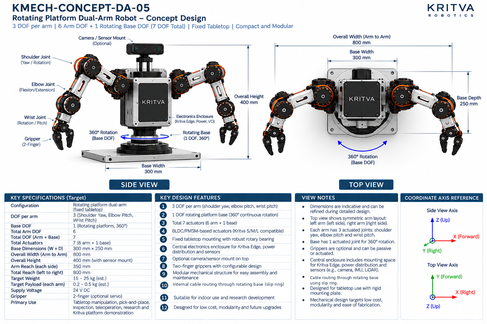
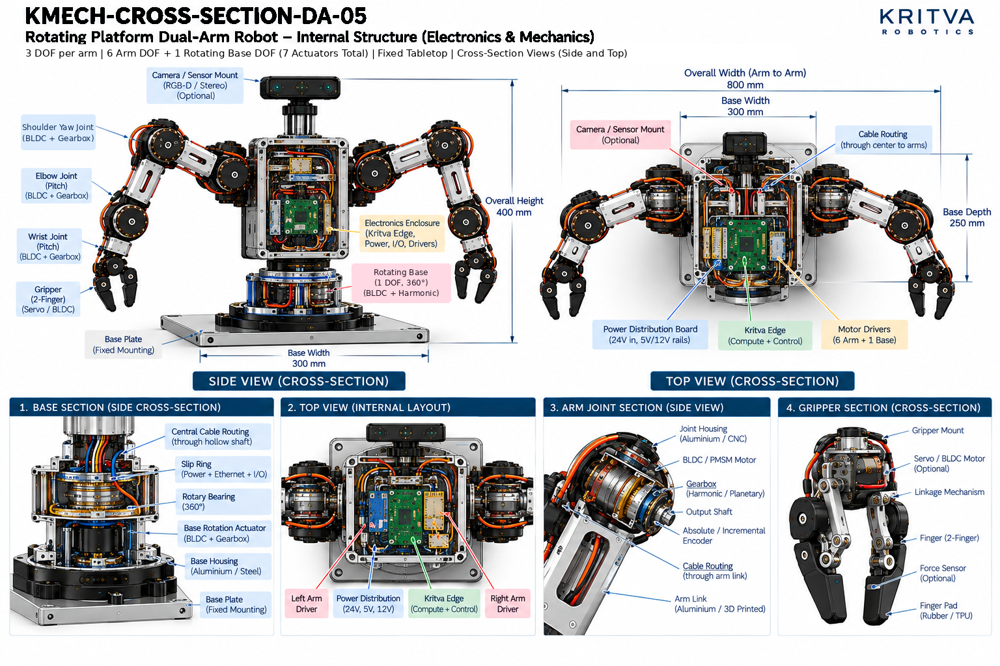

# DA-05 — Rotating Platform Dual-Arm

| Property | Value |
|---|---|
| Document ID | KMECH-CONCEPT-DA-05 |
| Repository | `KritvaOS/kritva-mechanical` |
| Document Type | Concept Overview |
| Status | PROPOSED |
| Owner | Dinesh |
| Assigned Intern | INTERN-03 |
| Version | 0.3.2 |
| Last Updated | 2026-10-31 |
| Authority | Feasibility study; subject to owner review |
| Related Documents | `feasibility/STUDY_PLAN.md`, `feasibility/REQUIREMENTS_REGISTER.md`, `docs/images/ARTWORK_MANIFEST.json`, `REQUIREMENTS.md`, `ARCHITECTURE.md` |

## 1. Purpose and Scope

DA-05 mounts two 3-DOF arms on a torso that sits on a rotating platform with one 360-degree base DOF, fixed to a tabletop plate. It tests whether a continuous base rotation can replace some arm DOF and widen the workspace for a low-cost tabletop robot. This README records what the two artwork sheets print and what the intern must investigate; it does not approve any value.

- Concept ID: DA-05
- Concept name: Rotating Platform Dual-Arm
- Family: Dual-arm
- Complexity: Medium (relative engineering category, not a validated assessment)
- Assigned intern: INTERN-03
- Assessment revision: none yet (NOT STARTED)

## 2. Reference Artwork

*Concept sheet: `docs/images/KMECH-CONCEPT-DA-05.png`. This is the primary configuration reference.*

*Cross-section sheet: `docs/images/KMECH-CROSS-SECTION-DA-05.png`. This is an illustrative internal arrangement.*

Both sheets are concept artwork (evidence type C, PROPOSED, maturity L0 as proposed in the planning discussion). They are not to scale, are not CAD, and are not engineering evidence. The earlier `.svg` sketch is superseded by these sheets.

## 3. Configuration

| Item | Value | Source |
|---|---|---|
| Robot type | Rotating-platform dual-arm, fixed tabletop mounting plate | Concept and Cross-section |
| Arms | 2 (left and right, symmetric) | Concept and Cross-section |
| DOF per arm | 3 (shoulder yaw, elbow pitch, wrist pitch) | Concept and Cross-section |
| Arm DOF | 6 | Concept and Cross-section |
| Base DOF | 1 (rotating platform, 360° continuous rotation) | Concept and Cross-section |
| Total DOF / actuators | 7 (6 arm + 1 base); grippers not counted | Concept and Cross-section |
| Gripper | 2-finger; optional servo or BLDC; may be passive | Concept and Cross-section |
| Sensors | Optional camera and sensor mount on top (RGB-D or stereo) | Concept and Cross-section |
| Mounting | Fixed tabletop, rigid mounting plate with robust rotary bearing | Concept and Cross-section |

## 4. CONCEPT_TARGET

Every value is printed on the artwork and is `CONCEPT_TARGET`: indicative, unapproved, and not a requirement. Requirements-register values stay `UNKNOWN` or `TBD` until the owner resolves them. Where the sheets disagree, both values are shown and marked `DISCREPANCY — OWNER REVIEW`; nothing is chosen by inference.

| Item | Value as printed | Source sheet | Status |
|---|---|---|---|
| Total actuators | 7 (6 arm + 1 base) | Concept | CONCEPT_TARGET |
| Overall width (arm to arm) | 800 mm | Concept and Cross-section | CONCEPT_TARGET |
| Total reach (left to right) | 800 mm | Concept | CONCEPT_TARGET |
| Base dimensions (W × D) | 300 mm × 250 mm | Concept and Cross-section | CONCEPT_TARGET |
| Overall height | 400 mm (with sensor mount) | Concept and Cross-section | CONCEPT_TARGET |
| Arm reach (each side) | 350 mm (shoulder to gripper) | Concept | CONCEPT_TARGET |
| Base rotation | 360°, continuous | Concept and Cross-section | CONCEPT_TARGET |
| Target payload (each arm) | 0.2 – 0.5 kg (est.) | Concept | CONCEPT_TARGET |
| Target weight | 15 – 25 kg (est.) | Concept | CONCEPT_TARGET |
| Supply voltage | 24 V DC (concept-level power indication, not a confirmed electrical interface) | Concept | CONCEPT_TARGET |
| Power rails shown inside | 24 V in; 5 V and 12 V rails | Cross-section | CONCEPT_TARGET |
| Primary use | Tabletop manipulation, pick-and-place, inspection, teleoperation, research and Kritva platform demonstration | Concept | CONCEPT_TARGET |
All dimensions, DOF and actuator counts printed on both sheets agree after the cross-section sheets were regenerated on 2026-10-31. A value printed on one sheet only names that sheet. The concept sheet's own view notes say dimensions are indicative. Items not printed on either sheet (for example joint torque, speed, stride, battery capacity, camera models) stay TBD.

## 5. Mechanical Architecture

Subsystem-level description from the sheets. Materials and mechanisms are options shown on the artwork, not selections. There is no CAD.

| Element | What the artwork shows | Status |
|---|---|---|
| Base plate | Fixed mounting plate, aluminium or steel, for tabletop mounting | Illustrative |
| Rotating base | Base housing with a rotary bearing (thrust and radial) and a slip ring for power and signals; the cross-section labels a base rotation actuator (BLDC + gearbox) and the rotating base (BLDC + harmonic); one DOF, 360° | Illustrative; see D4 |
| Torso / electronics enclosure | Central enclosure for Kritva Edge, power distribution, I/O and drivers, mounted on the rotating base | Illustrative |
| Arms | Aluminium or 3D-printed links, three joints per arm; cables through the links | Illustrative |
| Joint assemblies | Joint housing (aluminium or CNC) with a BLDC/PMSM motor, a harmonic or planetary gearbox, an output shaft and an absolute or incremental encoder | Illustrative |
| Grippers | Two-finger linkage on a gripper mount; optional servo or BLDC; optional force sensor; rubber or TPU finger pads | Illustrative |
| Sensor mount | Optional RGB-D or stereo camera on a short mast at the top of the torso | Optional |

## 6. Joint and Actuator Mapping

Mapping as printed on the sheets. Motor model, torque, speed, gear ratio and S/M/L assignment are not given by any approved source and stay TBD.

| Joint or actuator | Intended motion or axis | DOF | Proposed technology (as shown) | Baseline or optional |
|---|---|---|---|---|
| Base rotation | Rotation about the vertical axis, 360° continuous | 1 | Actuator not labelled on the current cross-section; concept sheet gives no type | Baseline |
| Shoulder (each arm) | Yaw / rotation (concept sheet and cross-section) | 1 | BLDC/PMSM with gearbox | Baseline |
| Elbow (each arm) | Pitch (flexion / extension) | 1 | BLDC/PMSM with gearbox | Baseline |
| Wrist (each arm) | Pitch (concept sheet label: rotation / pitch; see D2) | 1 | BLDC/PMSM with gearbox | Baseline |
| Gripper (each arm) | Parallel two-finger open and close | 0 (counted separately) | Optional servo or BLDC, as shown | Optional |

Count: 6 arm actuators (3 DOF × 2 arms) plus 1 base actuator = 7, as both sheets state. Gripper actuation is optional and not counted; its type and count are TBD. The concept sheet calls the actuators Kritva S/M/L compatible; this study has not mapped any joint to S, M or L. Joint axes are taken from the sheet labels, not inferred from rendered motor orientation.

## 7. Electronics and Power

Block-level placement and interfaces as shown on the sheets; there is no wiring schematic.

| Block | What the artwork shows | Status |
|---|---|---|
| Kritva Edge (compute and control) | Board in the torso electronics enclosure | Illustrative; board dimensions TBD |
| Power distribution board | 24 V in with 5 V and 12 V rails | Illustrative; electrical requirements TBD |
| Motor drivers | Left-arm driver and right-arm driver; the top view also says 6 arm plus 1 base drivers | Illustrative; driver selection TBD |
| Slip ring | Passes power and signals across the rotating joint (cross-section) | Illustrative; rating, channel count and life TBD |
| Sensors | Optional RGB-D or stereo camera on the mast; concept sheet also mentions space for IMU and LiDAR (not drawn on the cross-section) | Optional; sensor selection TBD |
| Power source | 24 V supply; whether external or on-board is not stated | UNKNOWN |

## 8. Cable Routing and Serviceability

Routes as labelled on the cross-section sheet. No harness design is implied.

- Cables pass through the base via a slip ring carrying power and signals.
- Cables run from the torso to both arms and through the arm links to the wrist and gripper.
- Both sheets now show the slip ring only; the owner selected the slip ring on 2026-10-31 and the cable loop is dropped.
- Concern to investigate: continuous 360° rotation needs the slip ring (D3 resolved); the slip ring adds signal-integrity, cost and life questions.

## 9. Risks and Unknowns

1. Continuous rotation needs a slip ring (or limited rotation); signal integrity of Ethernet and noise coupling from motor power through the slip ring are UNKNOWN.
2. Rotating-bearing moment load: arms extended with 15 – 25 kg (est.) mass produce a tipping moment on the bearing; not calculated.
3. Tabletop clearance: a 360° sweep of an 800 mm arm-to-arm span around a 300 mm base plate needs a stated free radius; not assessed.
4. Mounting plate and table stiffness: a rigid mounting interface is assumed, not designed.
5. Actuator sizing: base rotation inertia and arm torque are not derived; S/M/L compatibility is unassessed.
6. Printed weight (15 – 25 kg est.) looks high for a 400 mm tall tabletop robot and has no stated basis.

## 10. Artwork Discrepancies

| ID | Discrepancy | Sheets | Status |
|---|---|---|---|
| D1 | No dimension or DOF disagrees between the two sheets; width, base size, height, 6 arm DOF and 1 base DOF match | Both | NONE FOUND |
| D2 | Wrist terminology: the concept labels the wrist rotation / pitch while its specification and the cross-section state wrist pitch; one DOF per wrist is counted on both | Both | OPEN |
| D3 | Base cabling: the concept allowed a slip ring or a cable loop; the cross-section shows a slip ring only | Both | RESOLVED (owner decision 2026-10-31 and concept sheet regenerated 2026-10-31); both sheets now name the slip ring only |
| D4 | Base actuator: the concept gives no type for the base DOF; the cross-section does not draw or label a base actuator | Both | NOT VERIFIABLE FROM CURRENT ARTWORK |
| D5 | Cross-section subtitle rendering errors | Cross-section | RESOLVED (cross-section regenerated 2026-10-31) |
| D6 | Shoulder label: the earlier cross-section labelled the shoulder "Pitch" while the concept says yaw / rotation | Both | RESOLVED (cross-section regenerated 2026-10-31); it now reads "Shoulder Yaw Joint" |
| D7 | Wrist label printed twice on the front view of the earlier cross-section | Cross-section | RESOLVED (cross-section regenerated 2026-10-31); the wrist is labelled once |

The two sheets agree on width 800 mm, height 400 mm, base 300 mm × 250 mm, reach 350 mm (concept sheet), 3 DOF per arm, 1 rotating base DOF, 7 actuators. Review status: concept sheet `REVIEWED_WITH_ISSUES` (D2), cross-section `REVIEWED` in `docs/images/ARTWORK_MANIFEST.json` (Claude audit round 7; owner confirmation pending). REVIEWED is not design approval.

## 11. Feasibility Activity and Evidence

What the assigned intern investigates, using paper methods only (calculations, comparison tables, sketches and cited datasheets):

- [ ] Draw the kinematic sketch with the base rotation axis, three axes per arm and coordinate frames; estimate workspace and the benefit of base rotation (evidence C)
- [ ] Calculate the moment load on the rotary bearing for the extended-arm case with a stated mass and payload (evidence C)
- [ ] Estimate base rotation inertia and the torque and speed needed for a stated rotation time (evidence C)
- [ ] List the signals and power the slip ring carries and its life and noise limits (evidence C)
- [ ] Derive static torque at the arm joints for a stated payload and pose, then compare with S/M/L data once supplied (evidence C)
- [ ] State the free tabletop radius needed for a 360° sweep (evidence C)
- [ ] Record intern-generated cost assumptions separately from printed targets; no quotation or procurement

## 12. Revision and Traceability

| Item | Value |
|---|---|
| README revision | 0.3.1 |
| Concept sheet | `docs/images/KMECH-CONCEPT-DA-05.png` |
| Cross-section sheet | `docs/images/KMECH-CROSS-SECTION-DA-05.png` |
| Manifest | `docs/images/ARTWORK_MANIFEST.json` |
| Review state | Artwork audited by Claude (round 6, 2026-10-31); owner confirmation pending. This README records what the artwork prints and does not approve any value |

## 13. Folder Contents

This README and the two artwork sheets exist today. The files and folders below are created by the assigned intern as work progresses, using `feasibility/templates/`. There is no `cad/` folder while HOLD D-003 is active.

- `REQUIREMENTS.md`
- `ARCHITECTURE.md`
- `MECHANICAL_ANALYSIS.md`
- `ACTUATOR_ANALYSIS.md`
- `INTERFACES.md`
- `MASS_BUDGET.md`
- `COST_MODEL.md`
- `OPEN_QUESTIONS.md`
- `calculations/`
- `references/`
- `reviews/`
- `sketches/`

## 14. Current Assessment

- Overall status: NOT STARTED (README expanded from the artwork on 2026-10-31; no feasibility assessment has been performed)
- Requirements completeness: TBD
- Architecture assessment: TBD
- Engineering assessment: TBD
- Actuator compatibility: TBD
- Cost assessment: TBD
- Major risks: TBD
- Evidence gaps: TBD

## 15. Checkpoint Progress

| Checkpoint | Status | Review reference |
|---|---|---|
| CP2 | TBD | `reviews/` |
| CP3 | TBD | `reviews/` |
| CP4 | TBD | `reviews/` |

## 16. Open Decisions

1. D2 wrist label ("rotation / pitch" on the concept sheet, pitch on the cross-section) remains an owner decision; the other DA-05 artwork items are resolved.
2. LiDAR (concept sheet only) remains an owner decision across DA-03 and DA-05.
3. Whether grippers are powered in the baseline configuration (currently optional).
4. Payload, reach and weight targets remain `UNKNOWN` in the requirements register until resolved.
5. Joint to S/M/L actuator mapping is not started.

## 17. HOLD D-003

Paper feasibility work only. CAD, final BOM, quotations, procurement, fabrication, assembly and physical testing remain NOT STARTED and require explicit owner decision. This template does not authorize implementation.
