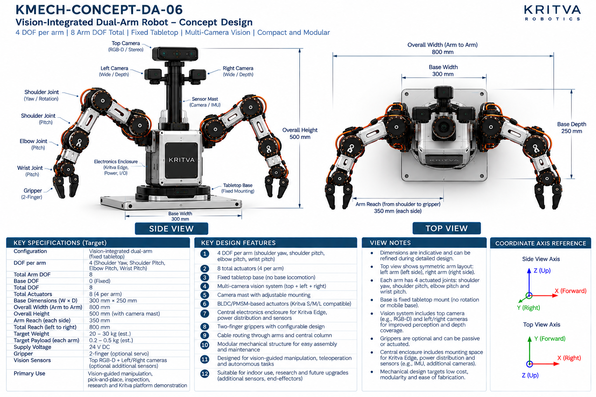
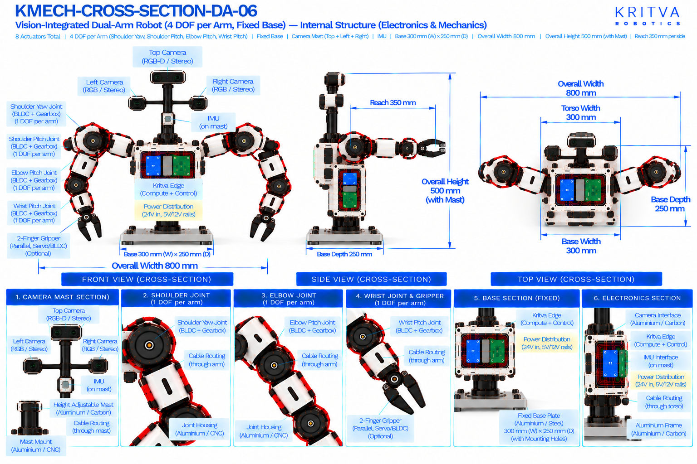

# DA-06 — Humanoid Upper-Body

| Property | Value |
|---|---|
| Document ID | KMECH-CONCEPT-DA-06 |
| Repository | `KritvaOS/kritva-mechanical` |
| Document Type | Concept Overview |
| Status | PROPOSED |
| Owner | Dinesh |
| Assigned Intern | INTERN-03 |
| Version | 0.3.1 |
| Last Updated | 2026-10-31 |
| Authority | Feasibility study; subject to owner review |
| Related Documents | `feasibility/STUDY_PLAN.md`, `feasibility/REQUIREMENTS_REGISTER.md`, `docs/images/ARTWORK_MANIFEST.json`, `REQUIREMENTS.md`, `ARCHITECTURE.md` |

## 1. Purpose and Scope

DA-06 is a fixed-tabletop dual-arm robot with 4-DOF arms and a multi-camera vision system on an adjustable-height mast, built for vision-guided manipulation, teleoperation and autonomous tasks. It tests how camera placement, mast design and cabling affect a compact dual-arm. This README records what the two artwork sheets print and what the intern must investigate; it does not approve any value. It also supersedes the earlier one-line study-plan definition of DA-06 (Humanoid Upper-Body), which is a reconciliation the owner must approve.

- Concept ID: DA-06
- Concept name: Vision-Integrated Dual-Arm
- Family: Dual-arm
- Complexity: Medium (relative engineering category, not a validated assessment)
- Assigned intern: INTERN-03
- Assessment revision: none yet (NOT STARTED)

## 2. Reference Artwork

*Concept sheet: `docs/images/KMECH-CONCEPT-DA-06.png`. This is the primary configuration reference.*

*Cross-section sheet: `docs/images/KMECH-CROSS-SECTION-DA-06.png`. This is an illustrative internal arrangement.*

Both sheets are concept artwork (evidence type C, PROPOSED, maturity L0 as proposed in the planning discussion). They are not to scale, are not CAD, and are not engineering evidence. The earlier `.svg` sketch is superseded by these sheets.

## 3. Configuration

| Item | Value | Source |
|---|---|---|
| Robot type | Vision-integrated dual-arm, fixed tabletop base, no base locomotion | Concept and Cross-section |
| Arms | 2 (left and right, symmetric) | Concept and Cross-section |
| DOF per arm | 4 (shoulder yaw, shoulder pitch, elbow pitch, wrist pitch) | Concept and Cross-section |
| Arm DOF | 8 | Concept and Cross-section |
| Base DOF | 0 (fixed) | Concept |
| Total DOF / actuators | 8 (4 per arm); grippers not counted | Concept |
| Gripper | 2-finger; optional servo; may be passive | Concept and Cross-section |
| Vision | Top RGB-D or stereo camera plus left and right wide or depth cameras, optional additional sensors | Concept and Cross-section |
| Sensor mast | Adjustable-height camera and sensor mast; the concept sheet labels it camera / IMU | Concept and Cross-section |

## 4. CONCEPT_TARGET

Every value is printed on the artwork and is `CONCEPT_TARGET`: indicative, unapproved, and not a requirement. Requirements-register values stay `UNKNOWN` or `TBD` until the owner resolves them. Where the sheets disagree, both values are shown and marked `DISCREPANCY — OWNER REVIEW`; nothing is chosen by inference.

| Item | Value as printed | Source sheet | Status |
|---|---|---|---|
| Total actuators | 8 (4 per arm) | Concept | CONCEPT_TARGET |
| Overall width (arm to arm) | 800 mm | Concept and Cross-section | CONCEPT_TARGET |
| Total reach (left to right) | 800 mm | Concept | CONCEPT_TARGET |
| Base dimensions (W × D) | 300 mm × 250 mm | Concept and Cross-section | CONCEPT_TARGET |
| Overall height | 500 mm (with camera mast) | Concept and Cross-section | CONCEPT_TARGET |
| Arm reach (each side) | 350 mm (shoulder to gripper) | Concept | CONCEPT_TARGET |
| Target payload (each arm) | 0.2 – 0.5 kg (est.) | Concept | CONCEPT_TARGET |
| Target weight | 20 – 30 kg (est.) | Concept | CONCEPT_TARGET |
| Supply voltage | 24 V DC (concept-level power indication, not a confirmed electrical interface) | Concept | CONCEPT_TARGET |
| Power rails shown inside | 24 V in; 5 V and 12 V rails | Cross-section | CONCEPT_TARGET |
| Primary use | Vision-guided manipulation, pick-and-place, inspection, teleoperation, research and Kritva platform demonstration | Concept | CONCEPT_TARGET |
| Torso width | 300 mm | Cross-section | CONCEPT_TARGET; not printed on the concept sheet — OWNER REVIEW |
All dimensions, DOF and actuator counts printed on both sheets agree after the cross-section sheets were regenerated on 2026-10-31. A value printed on one sheet only names that sheet. The concept sheet's own view notes say dimensions are indicative. Items not printed on either sheet (for example joint torque, speed, stride, battery capacity, camera models) stay TBD.

## 5. Mechanical Architecture

Subsystem-level description from the sheets. Materials and mechanisms are options shown on the artwork, not selections. There is no CAD.

| Element | What the artwork shows | Status |
|---|---|---|
| Tabletop base plate | Fixed mounting plate, aluminium or steel, for tabletop mounting; no rotation or mobility | Illustrative |
| Torso / electronics enclosure | Central enclosure for Kritva Edge, power distribution and I/O, with motor driver stacks for the left and right arms | Illustrative |
| Arms | Aluminium (CNC) or 3D-printed links, four joints per arm; cables through the arm links and shoulders | Illustrative |
| Joint assemblies | Joint housing with a BLDC/PMSM motor, a harmonic or planetary gearbox, an output shaft with an absolute or incremental encoder, and a timing belt where used | Illustrative |
| Grippers | Two-finger linkage on a gripper mount; optional servo; optional force sensor; rubber or TPU finger pads | Illustrative |
| Sensor mast | Vertical mast on the torso with adjustable height; carries the top camera and the left and right cameras; internal routing | Illustrative; see D3 |
| Vision module | Top RGB-D or stereo camera plus left and right wide or depth cameras | Illustrative; sensor selection TBD |

## 6. Joint and Actuator Mapping

Mapping as printed on the sheets. Motor model, torque, speed, gear ratio and S/M/L assignment are not given by any approved source and stay TBD.

| Joint or actuator | Intended motion or axis | DOF | Proposed technology (as shown) | Baseline or optional |
|---|---|---|---|---|
| Shoulder yaw (each arm) | Yaw / rotation | 1 | BLDC/PMSM with gearbox | Baseline |
| Shoulder pitch (each arm) | Pitch | 1 | BLDC/PMSM with gearbox | Baseline |
| Elbow (each arm) | Pitch | 1 | BLDC/PMSM with gearbox | Baseline |
| Wrist (each arm) | Pitch | 1 | BLDC/PMSM with gearbox | Baseline |
| Gripper (each arm) | Parallel two-finger open and close | 0 (counted separately) | Optional servo, as shown | Optional |
| Mast height | Adjustable; mechanism and whether it is powered are not stated | 0 (not counted) | Not stated | UNKNOWN |

Count: 8 arm actuators (4 DOF × 2 arms), and 0 base actuators because the base is fixed, as the concept sheet states. Gripper actuation is optional and not counted; its type and count are TBD. If the mast height is motorised it would add an actuator that the sheets do not count. The concept sheet calls the actuators Kritva S/M/L compatible; this study has not mapped any joint to S, M or L. Joint axes are taken from the sheet labels, not inferred from rendered motor orientation.

## 7. Electronics and Power

Block-level placement and interfaces as shown on the sheets; there is no wiring schematic.

| Block | What the artwork shows | Status |
|---|---|---|
| Kritva Edge (compute and control) | Board in the torso electronics enclosure | Illustrative; board dimensions TBD |
| Power distribution board | 24 V in with 5 V and 12 V rails | Illustrative; electrical requirements TBD |
| Motor drivers | Left-arm and right-arm driver stacks in the torso; not labelled on the current cross-section | Illustrative; driver selection TBD |
| Cameras | Top RGB-D or stereo plus left and right wide or depth; data path to Kritva Edge not specified | Illustrative; sensor selection TBD |
| IMU | On the camera mast (both sheets) | Optional; TBD |
| Power source | 24 V supply; external or on-board is not stated; no battery is shown | UNKNOWN |

## 8. Cable Routing and Serviceability

Routes as labelled on the cross-section sheet. No harness design is implied.

- Arm cables pass through the shoulders and the arm links to the wrist and gripper.
- The sensor mast has internal routing to the cameras, and the base section shows cables running to the arms and cameras.
- A cable route is labelled through the base.
- Concern to investigate: the adjustable-height mast needs slack or a telescoping path for camera power and data; the three-camera cable bundle may interfere with arm motion near the mast.

## 9. Risks and Unknowns

1. Mast stiffness and camera vibration: a 500 mm tall mast carrying three cameras while the arms move may blur images; UNKNOWN.
2. Camera placement relative to arm workspace and occlusion by the arms are UNKNOWN.
3. Hand-eye calibration needs repeatable camera mounting; the adjustable-height mast makes it harder.
4. Tipping and base fastening: arms extended with 20 – 30 kg (est.) on a 300 mm × 250 mm plate are not calculated; the weight looks high for a 500 mm tabletop robot and has no stated basis.
5. Actuator sizing: shoulder torque for 0.2 – 0.5 kg (est.) payload is not derived; S/M/L compatibility is unassessed.
6. Compute and data bandwidth for three cameras to Kritva Edge are not assessed.

## 10. Artwork Discrepancies

| ID | Discrepancy | Sheets | Status |
|---|---|---|---|
| D1 | No dimension or DOF disagrees between the two sheets; width, base size, height, 8 arm DOF and fixed base match | Both | NONE FOUND |
| D2 | Motor drivers labelled 'per joint' on the cross-section | Cross-section | RESOLVED (cross-section regenerated 2026-10-31); the label is no longer on the cross-section |
| D3 | Mast: both sheets say adjustable height but do not say how it adjusts, whether it is powered, or its travel; the actuator count excludes it | Both | OPEN — OWNER REVIEW |
| D4 | IMU: the concept labels the mast camera / IMU, the cross-section had no IMU | Both | RESOLVED (cross-section regenerated 2026-10-31); both sheets show an IMU on the mast |
| D5 | Cross-section title read 'KMECH-CONCEPT-DA-06' | Cross-section | RESOLVED (cross-section regenerated 2026-10-31) |
| D6 | Study-plan definition: STUDY_PLAN.md described DA-06 as Humanoid Upper-Body; both sheets show a fixed-tabletop vision-integrated dual-arm. STUDY_PLAN.md now carries the artwork definition as the baseline | Study plan | RESOLVED (owner decision 2026-10-31): redefinition approved |
| D7 | Torso width 300 mm is on the cross-section only | Cross-section | OPEN — OWNER REVIEW |

The two sheets agree on width 800 mm, height 500 mm with mast, base 300 mm × 250 mm, reach 350 mm, 4 DOF per arm, a fixed base, 8 actuators and the camera set. Review status: concept sheet `REVIEWED`, cross-section `REVIEWED_WITH_ISSUES` (D7) in `docs/images/ARTWORK_MANIFEST.json`. REVIEWED is not design approval.

## 11. Feasibility Activity and Evidence

What the assigned intern investigates, using paper methods only (calculations, comparison tables, sketches and cited datasheets):

- [ ] Draw the four-axis arm kinematic sketch with coordinate frames and estimate workspace; mark the camera fields of view against it (evidence C)
- [ ] Study camera placement: occlusion by the arms, mast height range and hand-eye calibration approach (evidence C)
- [ ] Estimate mast stiffness and first resonance for a stated mast section and camera mass (evidence C)
- [ ] Derive static torque at the arm joints for a stated payload and pose, then compare with S/M/L data once supplied (evidence C)
- [ ] Check base loading and fastening for the extended-arm case (evidence C)
- [ ] List camera power and data paths to Kritva Edge and cable routing for a movable mast (evidence C)
- [ ] Record intern-generated cost assumptions separately from printed targets; no quotation or procurement

## 12. Revision and Traceability

| Item | Value |
|---|---|
| README revision | 0.3.1 |
| Concept sheet | `docs/images/KMECH-CONCEPT-DA-06.png` |
| Cross-section sheet | `docs/images/KMECH-CROSS-SECTION-DA-06.png` |
| Manifest | `docs/images/ARTWORK_MANIFEST.json` |
| Review state | Artwork audited by Claude (round 6, 2026-10-31); owner confirmation pending. This README records what the artwork prints and does not approve any value |

## 13. Folder Contents

This README and the two artwork sheets exist today. The files and folders below are created by the assigned intern as work progresses, using `feasibility/templates/`. There is no `cad/` folder while HOLD D-003 is active.

- `REQUIREMENTS.md`
- `ARCHITECTURE.md`
- `MECHANICAL_ANALYSIS.md`
- `ACTUATOR_ANALYSIS.md`
- `INTERFACES.md`
- `MASS_BUDGET.md`
- `COST_MODEL.md`
- `OPEN_QUESTIONS.md`
- `calculations/`
- `references/`
- `reviews/`
- `sketches/`

## 14. Current Assessment

- Overall status: NOT STARTED (README expanded from the artwork on 2026-10-31; no feasibility assessment has been performed)
- Requirements completeness: TBD
- Architecture assessment: TBD
- Engineering assessment: TBD
- Actuator compatibility: TBD
- Cost assessment: TBD
- Major risks: TBD
- Evidence gaps: TBD

## 15. Checkpoint Progress

| Checkpoint | Status | Review reference |
|---|---|---|
| CP2 | TBD | `reviews/` |
| CP3 | TBD | `reviews/` |
| CP4 | TBD | `reviews/` |

## 16. Open Decisions

1. Torso width on the cross-section only (D7); the DA-06 definition is approved as baseline.
2. How the mast height is adjusted and whether it is powered (D3).
3. Whether the torso width on the cross-section is kept (D7).
4. Whether grippers are powered in the baseline configuration (currently optional).
5. Payload, reach and weight targets remain `UNKNOWN` in the requirements register until resolved.
6. Joint to S/M/L actuator mapping is not started.

## 17. HOLD D-003

Paper feasibility work only. CAD, final BOM, quotations, procurement, fabrication, assembly and physical testing remain NOT STARTED and require explicit owner decision. This template does not authorize implementation.
