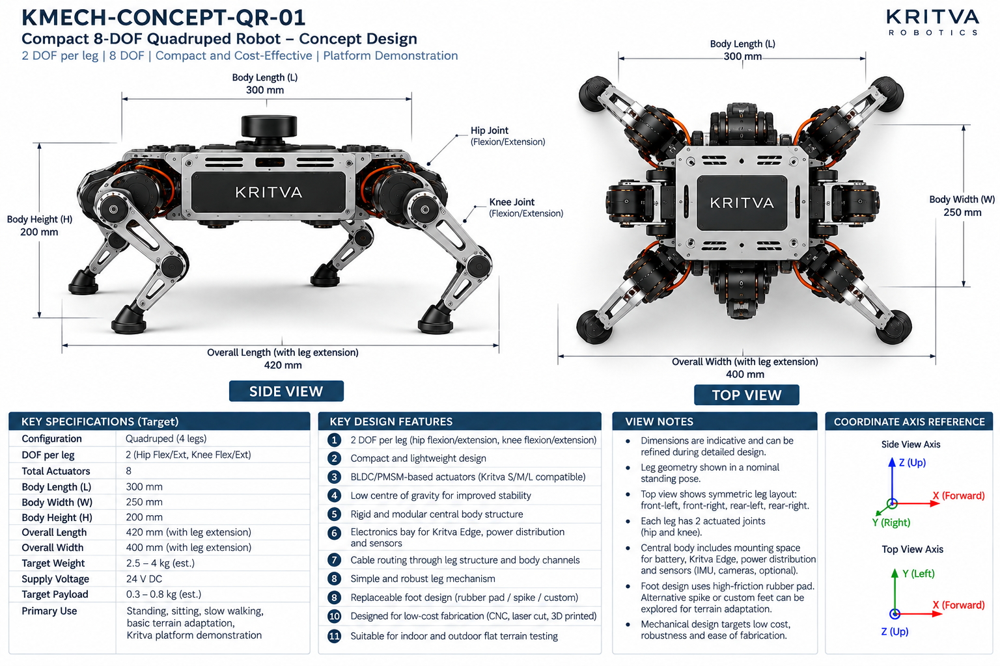
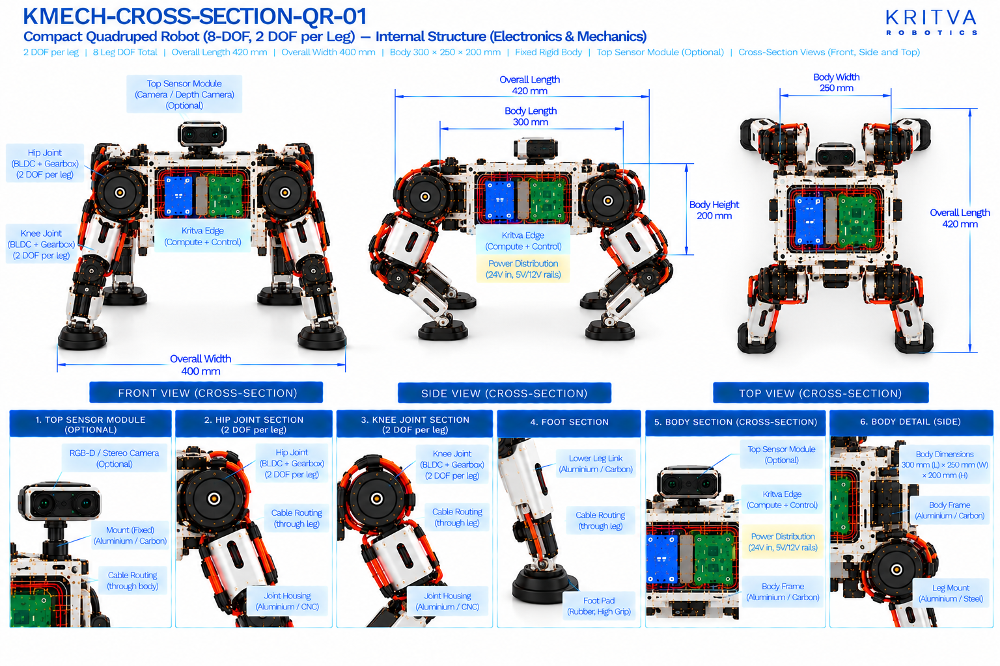

# QR-01 — Compact Quadruped

| Property | Value |
|---|---|
| Document ID | KMECH-CONCEPT-QR-01 |
| Repository | `KritvaOS/kritva-mechanical` |
| Document Type | Concept Overview |
| Status | PROPOSED |
| Owner | Dinesh |
| Assigned Intern | INTERN-02 |
| Version | 0.3.0 |
| Last Updated | 2026-10-31 |
| Authority | Feasibility study; subject to owner review |
| Related Documents | `feasibility/STUDY_PLAN.md`, `feasibility/REQUIREMENTS_REGISTER.md`, `docs/images/ARTWORK_MANIFEST.json`, `REQUIREMENTS.md`, `ARCHITECTURE.md` |

## 1. Purpose and Scope

QR-01 is the simplest legged concept: a compact four-legged robot with two DOF per leg (hip and knee flexion/extension, all in one plane), aimed at standing, sitting, slow walking and platform demonstration. This README records both sets of printed values and decides neither. It does not approve any value.

- Concept ID: QR-01
- Concept name: Compact Quadruped
- Family: Legged
- Complexity: Low (relative engineering category, not a validated assessment)
- Assigned intern: INTERN-02
- Assessment revision: none yet (NOT STARTED)

## 2. Reference Artwork

*Concept sheet: `docs/images/KMECH-CONCEPT-QR-01.png`. This is the primary configuration reference.*

*Cross-section sheet: `docs/images/KMECH-CROSS-SECTION-QR-01.png`. This is an illustrative internal arrangement.*

Both sheets are concept artwork (evidence type C, PROPOSED, maturity L0 as proposed in the planning discussion). They are not to scale, are not CAD, and are not engineering evidence. The earlier `.svg` sketch is superseded by these sheets.

## 3. Configuration

| Item | Value | Source |
|---|---|---|
| Robot type | Compact quadruped, four legs, fixed rigid body | Concept and Cross-section |
| Legs | 4 (front-left, front-right, rear-left, rear-right) | Concept and Cross-section |
| DOF per leg | 2 (hip flexion/extension, knee flexion/extension) | Concept and Cross-section |
| Total leg DOF | 8 | Concept and Cross-section |
| Feet | Replaceable rubber or TPU foot pad; spike or custom feet as options (concept) | Concept and Cross-section |
| Sensors | Optional top sensor module (RGB-D or stereo camera) on a fixed mount; the concept sheet also mentions IMU and optional LiDAR | Concept and Cross-section |
| Environment | Indoor and outdoor flat terrain testing | Concept |

## 4. CONCEPT_TARGET

Every value is printed on the artwork and is `CONCEPT_TARGET`: indicative, unapproved, and not a requirement. Requirements-register values stay `UNKNOWN` or `TBD` until the owner resolves them. Where the sheets disagree, both values are shown and marked `DISCREPANCY — OWNER REVIEW`; nothing is chosen by inference.

| Item | Value as printed | Source sheet | Status |
|---|---|---|---|
| Total actuators | 8 | Concept and Cross-section | CONCEPT_TARGET |
| Body length (L) | 300 mm | Concept and Cross-section | CONCEPT_TARGET |
| Body width (W) | 250 mm | Concept and Cross-section | CONCEPT_TARGET |
| Body height (H) | 200 mm | Concept and Cross-section | CONCEPT_TARGET |
| Overall length (with leg extension) | 420 mm | Concept and Cross-section | CONCEPT_TARGET |
| Overall width (with leg extension) | 400 mm | Concept and Cross-section | CONCEPT_TARGET |
| Target weight | 2.5 – 4 kg (est.) | Concept | CONCEPT_TARGET |
| Target payload | 0.3 – 0.8 kg (est.) | Concept | CONCEPT_TARGET |
| Supply voltage | 24 V DC (concept-level power indication, not a confirmed electrical interface) | Concept and Cross-section | CONCEPT_TARGET |
| Power rails shown inside | 24 V in; 5 V and 12 V rails | Cross-section | CONCEPT_TARGET |
| Primary use | Standing, sitting, slow walking, basic locomotion, Kritva platform demonstration | Concept | CONCEPT_TARGET |
All dimensions, DOF and actuator counts printed on both sheets agree after the cross-section sheets were regenerated on 2026-10-31. A value printed on one sheet only names that sheet. The concept sheet's own view notes say dimensions are indicative. Items not printed on either sheet (for example joint torque, speed, stride, battery capacity, camera models) stay TBD.

## 5. Mechanical Architecture

Subsystem-level description from the sheets. Materials and mechanisms are options shown on the artwork, not selections. There is no CAD.

| Element | What the artwork shows | Status |
|---|---|---|
| Body | Rigid central chassis in aluminium or carbon with an electronics bay for Kritva Edge and power distribution | Illustrative |
| Legs | Four symmetric two-joint planar legs (hip, knee), each ending in a foot pad | Illustrative |
| Joint assemblies | Joint housing (aluminium or CNC) with a BLDC/PMSM motor, a harmonic or planetary gearbox, an output shaft with an absolute or incremental encoder | Illustrative |
| Leg links | Thigh and lower leg links in aluminium (CNC) or 3D printed; cables routed through the link | Illustrative |
| Feet | Rubber or TPU pad; optional force sensor and elastomer damper in the foot section (cross-section) | Illustrative |
| Top sensor module | Optional camera / depth camera on a fixed mount in aluminium or carbon; IMU and LiDAR are on the concept sheet only | Optional |

## 6. Joint and Actuator Mapping

Mapping as printed on the sheets. Motor model, torque, speed, gear ratio and S/M/L assignment are not given by any approved source and stay TBD.

| Joint or actuator | Intended motion or axis | DOF | Proposed technology (as shown) | Baseline or optional |
|---|---|---|---|---|
| Hip (each leg) | Flexion / extension | 1 | BLDC/PMSM with gearbox | Baseline |
| Knee (each leg) | Flexion / extension; pitch | 1 | BLDC/PMSM with gearbox | Baseline |

Count: 2 DOF × 4 legs = 8 actuators; both sheets state 8. The concept sheet calls the actuators Kritva S/M/L compatible; this study has not mapped any joint to S, M or L. Joint axes are taken from the sheet labels, not inferred from rendered motor orientation.

## 7. Electronics and Power

Block-level placement and interfaces as shown on the sheets; there is no wiring schematic.

| Block | What the artwork shows | Status |
|---|---|---|
| Kritva Edge (compute and control) | Board in the central body | Illustrative; board dimensions TBD |
| Power distribution board | 24 V in with 5 V and 12 V rails | Illustrative; electrical requirements TBD |
| Motor drivers | Motor driver stack for four legs | Illustrative; driver selection TBD |
| Battery | Space for a battery in the body is mentioned on the concept sheet; no battery is drawn on the current cross-section | Illustrative; capacity, protection and charging TBD |
| Cooling | Not drawn on the current cross-section; thermal design TBD | UNKNOWN |
| Sensors | Optional top module with an RGB-D or stereo camera (cross-section); the concept sheet adds IMU and optional LiDAR | Optional; sensor selection TBD |

## 8. Cable Routing and Serviceability

Routes as labelled on the cross-section sheet. No harness design is implied.

- Cables run through the leg links to each joint.
- Cables are routed through leg structure and body channels (concept sheet).
- Concern to investigate: every leg joint moves relative to the body, so hip cables see repeated bend and, with an abduction hip, twist; this is not designed here.

## 9. Risks and Unknowns

1. A planar 2-DOF leg cannot move sideways; which gaits and tasks the concept can show is UNKNOWN until the kinematics are sketched.
2. Hip abduction (if 3 DOF) is needed for lateral balance; a planar 2-DOF leg cannot move sideways, which limits what gaits and tasks the concept can show.
3. Actuator sizing: peak knee and hip torque at the stated weight is not derived; S/M/L compatibility is unassessed.
4. Foot-ground contact (traction, impact) and battery runtime are not assessed.
5. Printed weight and payload targets have no stated basis.

## 10. Artwork Discrepancies

| ID | Discrepancy | Sheets | Status |
|---|---|---|---|
| D1 | DOF per leg: 2 (concept) vs 3 (cross-section) | Both | RESOLVED (cross-section regenerated 2026-10-31); both show 2 DOF per leg, 8 actuators |
| D2 | Body size: 300 × 250 × 200 mm (concept) vs 500 × 300 × 350 mm (cross-section) | Both | RESOLVED (cross-section regenerated 2026-10-31); both print 300 × 250 × 200 mm |
| D3 | Overall extents: 420 mm × 400 mm (concept) vs 500 mm (cross-section) and ambiguous length labels | Both | RESOLVED (cross-section regenerated 2026-10-31); both print 420 mm length and 400 mm width |
| D4 | Weight and payload appear on the concept sheet only | Concept | NOT VERIFIABLE FROM CURRENT ARTWORK |
| D5 | Sheet titles and variant: 'Compact 8-DOF Quadruped' vs 'Basic' with 3 DOF | Both | RESOLVED (cross-section regenerated 2026-10-31); titles now agree |
| D6 | Sensors: the concept sheet mentions IMU and optional LiDAR; the cross-section shows a camera only | Both | OPEN |

The two sheets now agree on four legs, 2 DOF per leg, 8 actuators, body 300 × 250 × 200 mm, overall 420 × 400 mm and Kritva Edge. Review status: concept sheet `REVIEWED`, cross-section `REVIEWED` in `docs/images/ARTWORK_MANIFEST.json`; D6 is a difference in optional sensors, not an error. REVIEWED is not design approval.

## 11. Feasibility Activity and Evidence

What the assigned intern investigates, using paper methods only (calculations, comparison tables, sketches and cited datasheets):

- [ ] Draw the leg kinematic sketch with joint axes and coordinate frames and estimate the foot workspace (evidence C)
- [ ] Estimate static joint torque for a stated body mass in a standing pose and a lifted-leg pose (evidence C)
- [ ] Check static stability margin for a simple walking gait with a stated stride (evidence C)
- [ ] Estimate mass by subsystem with assumptions listed, separately from the printed 2.5 – 4 kg (evidence C)
- [ ] Sketch the body layout for battery, Kritva Edge, drivers and the leg-hip interface (evidence C)
- [ ] List the cable path through leg links and hips (evidence C)
- [ ] Record intern-generated cost assumptions separately from printed targets; no quotation or procurement

## 12. Revision and Traceability

| Item | Value |
|---|---|
| README revision | 0.3.0 |
| Concept sheet | `docs/images/KMECH-CONCEPT-QR-01.png` |
| Cross-section sheet | `docs/images/KMECH-CROSS-SECTION-QR-01.png` |
| Manifest | `docs/images/ARTWORK_MANIFEST.json` |
| Review state | Artwork audited by Claude (round 6, 2026-10-31); owner confirmation pending. This README records what the artwork prints and does not approve any value |

## 13. Folder Contents

This README and the two artwork sheets exist today. The files and folders below are created by the assigned intern as work progresses, using `feasibility/templates/`. There is no `cad/` folder while HOLD D-003 is active.

- `REQUIREMENTS.md`
- `ARCHITECTURE.md`
- `MECHANICAL_ANALYSIS.md`
- `ACTUATOR_ANALYSIS.md`
- `INTERFACES.md`
- `MASS_BUDGET.md`
- `COST_MODEL.md`
- `OPEN_QUESTIONS.md`
- `calculations/`
- `references/`
- `reviews/`
- `sketches/`

## 14. Current Assessment

- Overall status: NOT STARTED (README expanded from the artwork on 2026-10-31; no feasibility assessment has been performed)
- Requirements completeness: TBD
- Architecture assessment: TBD
- Engineering assessment: TBD
- Actuator compatibility: TBD
- Cost assessment: TBD
- Major risks: TBD
- Evidence gaps: TBD

## 15. Checkpoint Progress

| Checkpoint | Status | Review reference |
|---|---|---|
| CP2 | TBD | `reviews/` |
| CP3 | TBD | `reviews/` |
| CP4 | TBD | `reviews/` |

## 16. Open Decisions

1. Which optional sensors belong to the baseline (D6); the owner decides.
2. Weight, payload and size targets remain `UNKNOWN` in the requirements register until resolved.
3. Joint to S/M/L actuator mapping is not started.

## 17. HOLD D-003

Paper feasibility work only. CAD, final BOM, quotations, procurement, fabrication, assembly and physical testing remain NOT STARTED and require explicit owner decision. This template does not authorize implementation.
