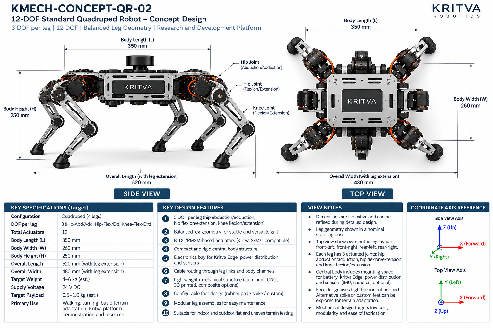
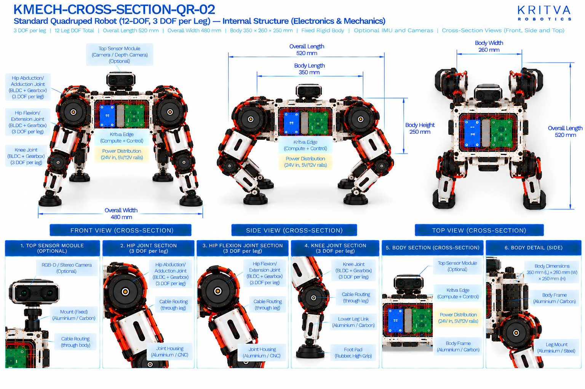

# QR-02 — Standard Quadruped

| Property | Value |
|---|---|
| Document ID | KMECH-CONCEPT-QR-02 |
| Repository | `KritvaOS/kritva-mechanical` |
| Document Type | Concept Overview |
| Status | PROPOSED |
| Owner | Dinesh |
| Assigned Intern | INTERN-01 |
| Version | 0.3.0 |
| Last Updated | 2026-10-31 |
| Authority | Feasibility study; subject to owner review |
| Related Documents | `feasibility/STUDY_PLAN.md`, `feasibility/REQUIREMENTS_REGISTER.md`, `docs/images/ARTWORK_MANIFEST.json`, `REQUIREMENTS.md`, `ARCHITECTURE.md` |

## 1. Purpose and Scope

QR-02 is the reference-geometry quadruped: four legs with three DOF each (hip abduction/adduction, hip or thigh flexion/extension, knee flexion/extension) for walking, turning and basic terrain adaptation on a research and development platform. This README records both sets of printed values and decides neither. It does not approve any value.

- Concept ID: QR-02
- Concept name: Standard Quadruped
- Family: Legged
- Complexity: Medium (relative engineering category, not a validated assessment)
- Assigned intern: INTERN-01
- Assessment revision: none yet (NOT STARTED)

## 2. Reference Artwork

*Concept sheet: `docs/images/KMECH-CONCEPT-QR-02.png`. This is the primary configuration reference.*

*Cross-section sheet: `docs/images/KMECH-CROSS-SECTION-QR-02.png`. This is an illustrative internal arrangement.*

Both sheets are concept artwork (evidence type C, PROPOSED, maturity L0 as proposed in the planning discussion). They are not to scale, are not CAD, and are not engineering evidence. The earlier `.svg` sketch is superseded by these sheets.

## 3. Configuration

| Item | Value | Source |
|---|---|---|
| Robot type | Standard quadruped, four legs, rigid body (cross-section subtitle: modular body) | Concept and Cross-section |
| Legs | 4 (front-left, front-right, rear-left, rear-right) | Concept and Cross-section |
| DOF per leg | 3 (hip abduction/adduction, hip or thigh flexion/extension, knee flexion/extension) | Concept and Cross-section |
| Total leg DOF / actuators | 12 | Concept and Cross-section |
| Feet | Replaceable rubber or TPU foot pad; spike or custom feet as options; optional force sensor (cross-section) | Concept and Cross-section |
| Sensors | Optional top sensor module (RGB-D or stereo camera) on a fixed mount; concept sheet: IMU and cameras optional | Concept and Cross-section |
| Environment | Indoor and outdoor flat and uneven terrain testing | Concept |

## 4. CONCEPT_TARGET

Every value is printed on the artwork and is `CONCEPT_TARGET`: indicative, unapproved, and not a requirement. Requirements-register values stay `UNKNOWN` or `TBD` until the owner resolves them. Where the sheets disagree, both values are shown and marked `DISCREPANCY — OWNER REVIEW`; nothing is chosen by inference.

| Item | Value as printed | Source sheet | Status |
|---|---|---|---|
| Total actuators | 12 | Concept | CONCEPT_TARGET |
| Body length (L) | 350 mm | Concept and Cross-section | CONCEPT_TARGET |
| Body width (W) | 260 mm | Concept and Cross-section | CONCEPT_TARGET |
| Body height (H) | 250 mm | Concept and Cross-section | CONCEPT_TARGET |
| Overall length (with leg extension) | 520 mm | Concept | CONCEPT_TARGET |
| Overall width (with leg extension) | 480 mm | Concept and Cross-section | CONCEPT_TARGET |
| Target weight | 4 – 6 kg (est.) | Concept | CONCEPT_TARGET |
| Target payload | 0.5 – 1.0 kg (est.) | Concept | CONCEPT_TARGET |
| Supply voltage | 24 V DC (concept-level power indication, not a confirmed electrical interface) | Concept and Cross-section | CONCEPT_TARGET |
| Power rails shown inside | 24 V in; 5 V and 12 V rails | Cross-section | CONCEPT_TARGET |
| Primary use | Walking, turning, basic terrain adaptation, research and development, Kritva platform demonstration | Concept | CONCEPT_TARGET |
All dimensions, DOF and actuator counts printed on both sheets agree after the cross-section sheets were regenerated on 2026-10-31. A value printed on one sheet only names that sheet. The concept sheet's own view notes say dimensions are indicative. Items not printed on either sheet (for example joint torque, speed, stride, battery capacity, camera models) stay TBD.

## 5. Mechanical Architecture

Subsystem-level description from the sheets. Materials and mechanisms are options shown on the artwork, not selections. There is no CAD.

| Element | What the artwork shows | Status |
|---|---|---|
| Body | Rigid central chassis in aluminium or carbon with an electronics bay for Kritva Edge and power distribution | Illustrative |
| Legs | Four symmetric three-joint legs (hip abduction/adduction, hip flexion/extension, knee), each ending in a foot pad | Illustrative |
| Joint assemblies | Joint housing (aluminium or CNC) with a BLDC/PMSM motor, a harmonic or planetary gearbox, an output shaft with an absolute or incremental encoder | Illustrative |
| Leg links | Hip, thigh and lower leg links in aluminium (CNC) or 3D printed; composite options named on the concept sheet; cables through the links | Illustrative |
| Feet | Rubber or TPU pad; optional force sensor and elastomer damper | Illustrative |
| Sensor module | Optional top sensor module (RGB-D or stereo camera) on a fixed aluminium or carbon mount | Optional |

## 6. Joint and Actuator Mapping

Mapping as printed on the sheets. Motor model, torque, speed, gear ratio and S/M/L assignment are not given by any approved source and stay TBD.

| Joint or actuator | Intended motion or axis | DOF | Proposed technology (as shown) | Baseline or optional |
|---|---|---|---|---|
| Hip abduction/adduction (each leg) | Abduction / adduction | 1 | BLDC/PMSM with gearbox | Baseline |
| Hip or thigh (each leg) | Flexion / extension (cross-section: thigh pitch) | 1 | BLDC/PMSM with gearbox | Baseline |
| Knee (each leg) | Flexion / extension (cross-section: pitch) | 1 | BLDC/PMSM with gearbox | Baseline |

Count: 3 DOF × 4 legs = 12 actuators; both sheets state 12. The concept sheet calls the actuators Kritva S/M/L compatible; this study has not mapped any joint to S, M or L. Joint axes are taken from the sheet labels, not inferred from rendered motor orientation.

## 7. Electronics and Power

Block-level placement and interfaces as shown on the sheets; there is no wiring schematic.

| Block | What the artwork shows | Status |
|---|---|---|
| Kritva Edge (compute and control) | Board in the central body | Illustrative; board dimensions TBD |
| Power distribution board | 24 V in with 5 V and 12 V rails | Illustrative; electrical requirements TBD |
| Motor drivers | Motor driver stack for four legs | Illustrative; driver selection TBD |
| Battery | Space for a battery in the body is mentioned on the concept sheet; no battery is drawn on the current cross-section | Illustrative; capacity, protection and charging TBD |
| Cooling | Not drawn on the current cross-section; thermal design TBD | UNKNOWN |
| Sensors | Optional top module with an RGB-D or stereo camera; the concept sheet says IMU and cameras are optional | Optional; sensor selection TBD |

## 8. Cable Routing and Serviceability

Routes as labelled on the cross-section sheet. No harness design is implied.

- Left-leg and right-leg cable routing passes through the hip.
- Cables run through the hip, thigh and lower leg links to each joint.
- Cables are routed through leg links and body channels (concept sheet).
- Concern to investigate: the abduction hip adds twist on top of bend at the hip cable passage; this is not designed here.

## 9. Risks and Unknowns

1. Actuator sizing: peak hip abduction, thigh and knee torque at 4 – 6 kg (est.) is not derived; S/M/L compatibility is unassessed.
2. Leg geometry: link lengths, joint offsets and workspace are not specified; the 'balanced leg geometry' claim is unverified.
3. Battery runtime and thermal behaviour in a closed body are not assessed.
4. Foot-ground contact (traction, impact) is not assessed.

## 10. Artwork Discrepancies

| ID | Discrepancy | Sheets | Status |
|---|---|---|---|
| D1 | Body size: 350 × 260 × 250 mm (concept) vs 600 × 350 × 400 mm (cross-section); overall width 480 mm vs 500 mm | Both | RESOLVED (cross-section regenerated 2026-10-31); both print 350 × 260 × 250 mm, overall 520 × 480 mm |
| D2 | Sheet titles: 'Standard Quadruped' vs 'Advanced' with an advanced sensor suite | Both | RESOLVED (cross-section regenerated 2026-10-31); the advanced suite is removed |
| D3 | Sensors: the concept says IMU and cameras optional; the cross-section shows a camera only | Both | OPEN |
| D4 | Joint naming: hip flexion/extension vs thigh pitch | Both | RESOLVED (cross-section regenerated 2026-10-31); both use hip flexion/extension |
| D5 | Weight, payload and overall length with legs appear on the concept sheet only | Concept | NOT VERIFIABLE FROM CURRENT ARTWORK |

The two sheets now agree on four legs, 3 DOF per leg, 12 actuators, body 350 × 260 × 250 mm and overall 520 × 480 mm. Review status: concept sheet `REVIEWED`, cross-section `REVIEWED` in `docs/images/ARTWORK_MANIFEST.json`; D3 is a difference in optional sensors, not an error. REVIEWED is not design approval.

## 11. Feasibility Activity and Evidence

What the assigned intern investigates, using paper methods only (calculations, comparison tables, sketches and cited datasheets):

- [ ] Draw the leg kinematic sketch for three joints with axes and coordinate frames; estimate foot workspace (evidence C)
- [ ] Estimate static joint torque for a stated body mass in standing and lifted-leg poses (evidence C)
- [ ] Check static stability margin for a simple walking gait with a stated stride (evidence C)
- [ ] Estimate mass by subsystem with assumptions listed, separately from the printed 4 – 6 kg (evidence C)
- [ ] Sketch the body layout with battery, Kritva Edge, drivers and sensors and the hip interface (evidence C)
- [ ] List cable paths through the hip and leg links (evidence C)
- [ ] Record intern-generated cost assumptions separately from printed targets; no quotation or procurement

## 12. Revision and Traceability

| Item | Value |
|---|---|
| README revision | 0.3.0 |
| Concept sheet | `docs/images/KMECH-CONCEPT-QR-02.png` |
| Cross-section sheet | `docs/images/KMECH-CROSS-SECTION-QR-02.png` |
| Manifest | `docs/images/ARTWORK_MANIFEST.json` |
| Review state | Artwork audited by Claude (round 6, 2026-10-31); owner confirmation pending. This README records what the artwork prints and does not approve any value |

## 13. Folder Contents

This README and the two artwork sheets exist today. The files and folders below are created by the assigned intern as work progresses, using `feasibility/templates/`. There is no `cad/` folder while HOLD D-003 is active.

- `REQUIREMENTS.md`
- `ARCHITECTURE.md`
- `MECHANICAL_ANALYSIS.md`
- `ACTUATOR_ANALYSIS.md`
- `INTERFACES.md`
- `MASS_BUDGET.md`
- `COST_MODEL.md`
- `OPEN_QUESTIONS.md`
- `calculations/`
- `references/`
- `reviews/`
- `sketches/`

## 14. Current Assessment

- Overall status: NOT STARTED (README expanded from the artwork on 2026-10-31; no feasibility assessment has been performed)
- Requirements completeness: TBD
- Architecture assessment: TBD
- Engineering assessment: TBD
- Actuator compatibility: TBD
- Cost assessment: TBD
- Major risks: TBD
- Evidence gaps: TBD

## 15. Checkpoint Progress

| Checkpoint | Status | Review reference |
|---|---|---|
| CP2 | TBD | `reviews/` |
| CP3 | TBD | `reviews/` |
| CP4 | TBD | `reviews/` |

## 16. Open Decisions

1. Which optional sensors belong to the baseline (D3); the owner decides.
2. Weight and payload targets remain `UNKNOWN` in the requirements register until resolved.
3. Joint to S/M/L actuator mapping is not started.

## 17. HOLD D-003

Paper feasibility work only. CAD, final BOM, quotations, procurement, fabrication, assembly and physical testing remain NOT STARTED and require explicit owner decision. This template does not authorize implementation.
