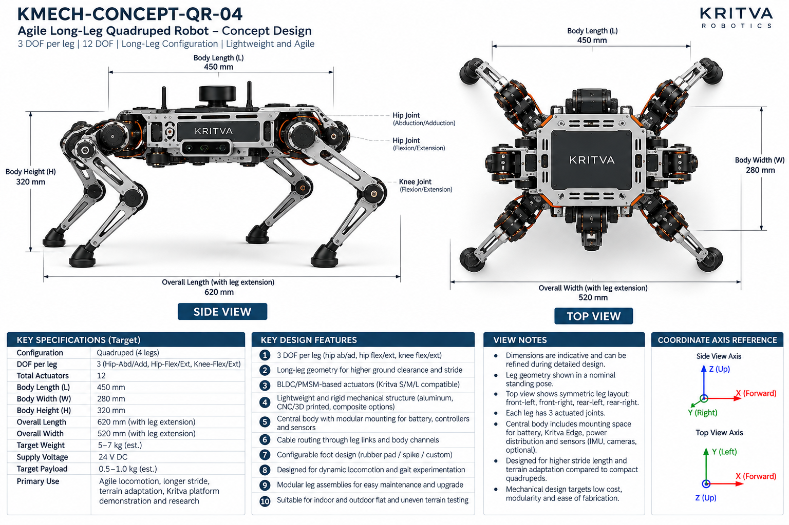
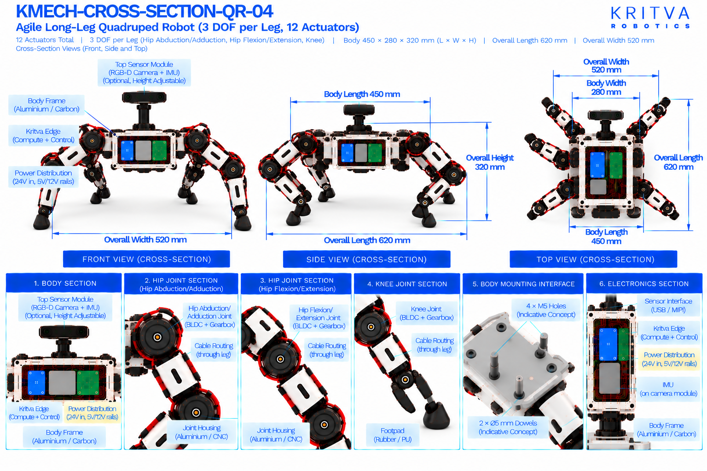

# QR-04 — Agile Long-Leg Quadruped

| Property | Value |
|---|---|
| Document ID | KMECH-CONCEPT-QR-04 |
| Repository | `KritvaOS/kritva-mechanical` |
| Document Type | Concept Overview |
| Status | PROPOSED |
| Owner | Dinesh |
| Assigned Intern | INTERN-01 |
| Version | 0.3.0 |
| Last Updated | 2026-10-31 |
| Authority | Feasibility study; subject to owner review |
| Related Documents | `feasibility/STUDY_PLAN.md`, `feasibility/REQUIREMENTS_REGISTER.md`, `docs/images/ARTWORK_MANIFEST.json`, `REQUIREMENTS.md`, `ARCHITECTURE.md` |

## 1. Purpose and Scope

QR-04 is the long-leg, higher-ground-clearance quadruped aimed at longer stride, agile and dynamic locomotion and gait experimentation: four legs with three DOF each. This README records both sets of printed values and decides neither. It does not approve any value.

- Concept ID: QR-04
- Concept name: Agile Long-Leg Quadruped
- Family: Legged
- Complexity: High (relative engineering category, not a validated assessment)
- Assigned intern: INTERN-01
- Assessment revision: none yet (NOT STARTED)

## 2. Reference Artwork

*Concept sheet: `docs/images/KMECH-CONCEPT-QR-04.png`. This is the primary configuration reference.*

*Cross-section sheet: `docs/images/KMECH-CROSS-SECTION-QR-04.png`. This is an illustrative internal arrangement.*

Both sheets are concept artwork (evidence type C, PROPOSED, maturity L0 as proposed in the planning discussion). They are not to scale, are not CAD, and are not engineering evidence. The earlier `.svg` sketch is superseded by these sheets.

## 3. Configuration

| Item | Value | Source |
|---|---|---|
| Robot type | Agile long-leg quadruped, four legs, lightweight rigid body | Concept and Cross-section |
| Legs | 4 (front-left, front-right, rear-left, rear-right), long-leg geometry | Concept and Cross-section |
| DOF per leg | 3 (hip abduction/adduction, hip or thigh flexion/extension, knee flexion/extension) | Concept and Cross-section |
| Total leg DOF / actuators | 12 | Concept and Cross-section |
| Feet | Configurable rubber pad, spike or custom (concept); interchangeable rubber or TPU with force sensor (cross-section) | Concept and Cross-section |
| Sensors and compute | Optional top sensor module (RGB-D camera and IMU), height adjustable; Kritva Edge compute | Concept and Cross-section |
| Environment | Indoor and outdoor flat and uneven terrain testing | Concept |

## 4. CONCEPT_TARGET

Every value is printed on the artwork and is `CONCEPT_TARGET`: indicative, unapproved, and not a requirement. Requirements-register values stay `UNKNOWN` or `TBD` until the owner resolves them. Where the sheets disagree, both values are shown and marked `DISCREPANCY — OWNER REVIEW`; nothing is chosen by inference.

| Item | Value as printed | Source sheet | Status |
|---|---|---|---|
| Total actuators | 12 | Concept | CONCEPT_TARGET |
| Body length (L) | 450 mm | Concept and Cross-section | CONCEPT_TARGET |
| Body width (W) | 280 mm | Concept and Cross-section | CONCEPT_TARGET |
| Body height (H) | 320 mm | Concept and Cross-section | CONCEPT_TARGET |
| Overall length (with leg extension) | 620 mm | Concept | CONCEPT_TARGET |
| Overall width (with leg extension) | 520 mm | Concept and Cross-section | CONCEPT_TARGET |
| Target weight | 5 – 7 kg (est.) | Concept | CONCEPT_TARGET |
| Target payload | 0.5 – 1.0 kg (est.) | Concept | CONCEPT_TARGET |
| Supply voltage | 24 V DC (concept-level power indication, not a confirmed electrical interface) | Concept and Cross-section | CONCEPT_TARGET |
| Power rails shown inside | 24 V in; 5 V and 12 V rails | Cross-section | CONCEPT_TARGET |
| Primary use | Agile locomotion, longer stride, terrain adaptation, gait experimentation, research, Kritva platform demonstration | Concept | CONCEPT_TARGET |
All dimensions, DOF and actuator counts printed on both sheets agree after the cross-section sheets were regenerated on 2026-10-31. A value printed on one sheet only names that sheet. The concept sheet's own view notes say dimensions are indicative. Items not printed on either sheet (for example joint torque, speed, stride, battery capacity, camera models) stay TBD.

## 5. Mechanical Architecture

Subsystem-level description from the sheets. Materials and mechanisms are options shown on the artwork, not selections. There is no CAD.

| Element | What the artwork shows | Status |
|---|---|---|
| Body | Rigid central chassis in aluminium or carbon with modular mounting for controllers and sensors | Illustrative |
| Legs | Four symmetric three-joint long legs (hip abduction/adduction, hip flexion/extension, knee), each ending in a rubber / PU footpad | Illustrative |
| Joint assemblies | Joint housing (aluminium or CNC) with a BLDC/PMSM motor, a harmonic or planetary gearbox, an output shaft with an absolute or incremental encoder | Illustrative |
| Feet | Rubber / PU footpad | Illustrative |
| Sensor module and body mounting interface | Optional top sensor module on a height-adjustable mount; Body mounting interface: 4 × M5 holes and 2 × Ø5 mm dowels labelled 'indicative concept' on the cross-section only | Optional; see D7 |

## 6. Joint and Actuator Mapping

Mapping as printed on the sheets. Motor model, torque, speed, gear ratio and S/M/L assignment are not given by any approved source and stay TBD.

| Joint or actuator | Intended motion or axis | DOF | Proposed technology (as shown) | Baseline or optional |
|---|---|---|---|---|
| Hip abduction/adduction (each leg) | Abduction / adduction | 1 | BLDC/PMSM with gearbox | Baseline |
| Hip or thigh (each leg) | Flexion / extension (cross-section: thigh pitch) | 1 | BLDC/PMSM with gearbox | Baseline |
| Knee (each leg) | Flexion / extension (cross-section: pitch) | 1 | BLDC/PMSM with gearbox | Baseline |

Count: 3 DOF × 4 legs = 12 actuators; both sheets state 12. No ankle or foot actuator is drawn. The concept sheet calls the actuators Kritva S/M/L compatible; this study has not mapped any joint to S, M or L. Joint axes are taken from the sheet labels, not inferred from rendered motor orientation.

## 7. Electronics and Power

Block-level placement and interfaces as shown on the sheets; there is no wiring schematic.

| Block | What the artwork shows | Status |
|---|---|---|
| Compute | Kritva Edge on the body; the cross-section labels no other compute option | Illustrative; board dimensions TBD |
| Power distribution board | 24 V in with 5 V and 12 V rails | Illustrative; electrical requirements TBD |
| Motor drivers | Driver stack for four legs; the top section shows left and right driver blocks | Illustrative; driver selection TBD |
| Battery | Space for a battery in the body is mentioned on the concept sheet; no battery is drawn on the current cross-section | Illustrative; capacity, protection and charging TBD |
| Cooling | Not drawn on the current cross-section; thermal design TBD | UNKNOWN |
| Sensors | Optional top module with an RGB-D camera and an IMU on the camera module; USB / MIPI sensor interface | Optional; sensor selection TBD |

## 8. Cable Routing and Serviceability

Routes as labelled on the cross-section sheet. No harness design is implied.

- Left-leg and right-leg cable routing passes through the hip.
- Cables run through the hip, thigh and lower leg links; the cross-section shows carbon or aluminium links with internal routing.
- Cables are routed through leg links and body channels (concept sheet).
- Concern to investigate: long legs lengthen the cable path and raise flex-fatigue risk; not designed here.

## 9. Risks and Unknowns

1. The body mounting interface (D7) is not on the concept sheet; its loads and tolerance effects are UNKNOWN until the owner decides.
2. Dynamic locomotion: long legs with the printed 3 DOF need high joint torque and speed; peak torque and impact loads are not derived.
3. Mass: 5 – 7 kg (est.) with long legs raises leg inertia; actuator sizing and S/M/L compatibility are unassessed.
4. Carbon links and composite options are named without any process, cost or supplier assessment.
5. Battery runtime and thermal behaviour in a closed body are not assessed.

## 10. Artwork Discrepancies

| ID | Discrepancy | Sheets | Status |
|---|---|---|---|
| D1 | Body size: 450 × 280 × 320 mm (concept) vs 800 × 380 × 450 mm (cross-section); overall width 520 mm vs 620 mm | Both | RESOLVED (cross-section regenerated 2026-10-31); both print 450 × 280 × 320 mm, overall 620 × 520 mm |
| D2 | Sheet titles: 'Agile Long-Leg' vs 'High-Performance' with advanced compute and sensing | Both | RESOLVED (cross-section regenerated 2026-10-31); titles agree, advanced suite removed |
| D3 | Compute 'Kritva Nexus' on the cross-section | Cross-section | RESOLVED (cross-section regenerated 2026-10-31); Kritva Edge only |
| D4 | Optional ankle/foot actuator on the cross-section | Cross-section | RESOLVED (cross-section regenerated 2026-10-31); removed |
| D5 | Joint naming: hip flexion/extension vs thigh pitch | Both | RESOLVED (cross-section regenerated 2026-10-31); both use hip flexion/extension |
| D6 | Weight, payload and overall length with legs appear on the concept sheet only | Concept | NOT VERIFIABLE FROM CURRENT ARTWORK |
| D7 | Body mounting interface (4 × M5 holes, 2 × Ø5 mm dowels, 'indicative concept') and a height-adjustable sensor module are on the cross-section only | Cross-section | OPEN — OWNER REVIEW |

The two sheets now agree on four legs, 3 DOF per leg, 12 actuators, body 450 × 280 × 320 mm and overall 620 × 520 mm. Review status: concept sheet `REVIEWED`, cross-section `REVIEWED_WITH_ISSUES` (D7) in `docs/images/ARTWORK_MANIFEST.json`. REVIEWED is not design approval.

## 11. Feasibility Activity and Evidence

What the assigned intern investigates, using paper methods only (calculations, comparison tables, sketches and cited datasheets):

- [ ] Draw the long-leg kinematic sketch with axes and frames; estimate foot workspace and stride (evidence C)
- [ ] Estimate static and peak dynamic joint torque for a stated mass, stride and leg inertia (evidence C)
- [ ] Check static stability margin and centre-of-gravity height for a trotting gait (evidence C)
- [ ] Estimate mass by subsystem with assumptions listed, separately from the printed 5 – 7 kg (evidence C)
- [ ] Compare lighter leg materials against the printed options on a paper basis, with no supplier contact (evidence C)
- [ ] Sketch the body layout for battery, compute, drivers and sensor modules (evidence C)
- [ ] Record intern-generated cost assumptions separately from printed targets; no quotation or procurement

## 12. Revision and Traceability

| Item | Value |
|---|---|
| README revision | 0.3.0 |
| Concept sheet | `docs/images/KMECH-CONCEPT-QR-04.png` |
| Cross-section sheet | `docs/images/KMECH-CROSS-SECTION-QR-04.png` |
| Manifest | `docs/images/ARTWORK_MANIFEST.json` |
| Review state | Artwork audited by Claude (round 6, 2026-10-31); owner confirmation pending. This README records what the artwork prints and does not approve any value |

## 13. Folder Contents

This README and the two artwork sheets exist today. The files and folders below are created by the assigned intern as work progresses, using `feasibility/templates/`. There is no `cad/` folder while HOLD D-003 is active.

- `REQUIREMENTS.md`
- `ARCHITECTURE.md`
- `MECHANICAL_ANALYSIS.md`
- `ACTUATOR_ANALYSIS.md`
- `INTERFACES.md`
- `MASS_BUDGET.md`
- `COST_MODEL.md`
- `OPEN_QUESTIONS.md`
- `calculations/`
- `references/`
- `reviews/`
- `sketches/`

## 14. Current Assessment

- Overall status: NOT STARTED (README expanded from the artwork on 2026-10-31; no feasibility assessment has been performed)
- Requirements completeness: TBD
- Architecture assessment: TBD
- Engineering assessment: TBD
- Actuator compatibility: TBD
- Cost assessment: TBD
- Major risks: TBD
- Evidence gaps: TBD

## 15. Checkpoint Progress

| Checkpoint | Status | Review reference |
|---|---|---|
| CP2 | TBD | `reviews/` |
| CP3 | TBD | `reviews/` |
| CP4 | TBD | `reviews/` |

## 16. Open Decisions

1. Whether the body mounting interface and the height-adjustable sensor module are kept (D7); the owner decides.
2. Weight and payload targets remain `UNKNOWN` in the requirements register until resolved.
3. Joint to S/M/L actuator mapping is not started.

## 17. HOLD D-003

Paper feasibility work only. CAD, final BOM, quotations, procurement, fabrication, assembly and physical testing remain NOT STARTED and require explicit owner decision. This template does not authorize implementation.
