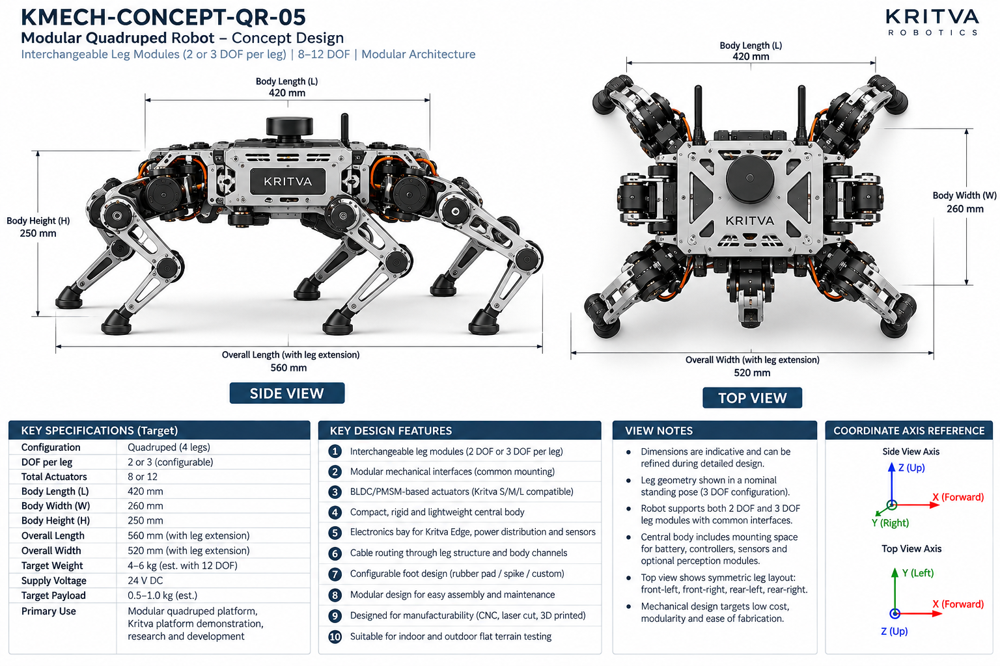
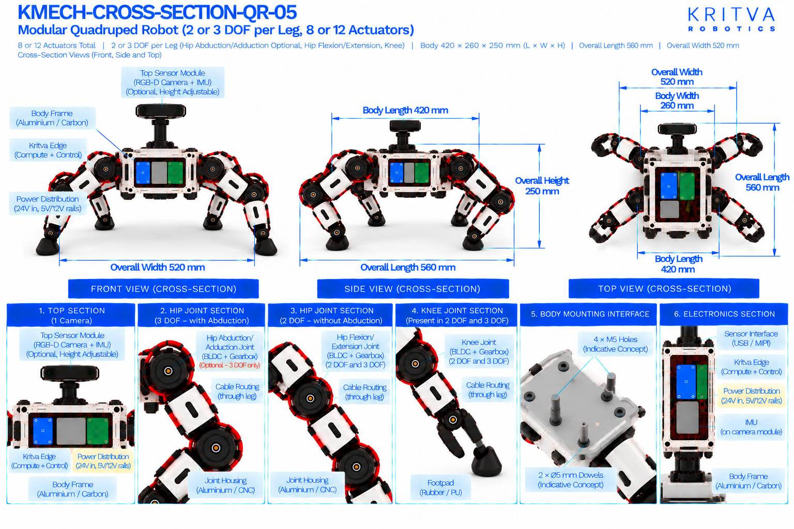

# QR-05 — Modular Quadruped

| Property | Value |
|---|---|
| Document ID | KMECH-CONCEPT-QR-05 |
| Repository | `KritvaOS/kritva-mechanical` |
| Document Type | Concept Overview |
| Status | PROPOSED |
| Owner | Dinesh |
| Assigned Intern | INTERN-02 |
| Version | 0.3.0 |
| Last Updated | 2026-10-31 |
| Authority | Feasibility study; subject to owner review |
| Related Documents | `feasibility/STUDY_PLAN.md`, `feasibility/REQUIREMENTS_REGISTER.md`, `docs/images/ARTWORK_MANIFEST.json`, `REQUIREMENTS.md`, `ARCHITECTURE.md` |

## 1. Purpose and Scope

QR-05 is the modular quadruped: a central body with interchangeable leg modules (2 or 3 DOF per leg, 8 or 12 actuators) on common mounting interfaces, to study modularity, maintenance and upgrade paths. This README records both sets of printed values and decides neither. It does not approve any value.

- Concept ID: QR-05
- Concept name: Modular Quadruped
- Family: Legged
- Complexity: High (relative engineering category, not a validated assessment)
- Assigned intern: INTERN-02
- Assessment revision: none yet (NOT STARTED)

## 2. Reference Artwork

*Concept sheet: `docs/images/KMECH-CONCEPT-QR-05.png`. This is the primary configuration reference.*

*Cross-section sheet: `docs/images/KMECH-CROSS-SECTION-QR-05.png`. This is an illustrative internal arrangement.*

Both sheets are concept artwork (evidence type C, PROPOSED, maturity L0 as proposed in the planning discussion). They are not to scale, are not CAD, and are not engineering evidence. The earlier `.svg` sketch is superseded by these sheets.

## 3. Configuration

| Item | Value | Source |
|---|---|---|
| Robot type | Modular quadruped with interchangeable leg modules on a compact central body | Concept and Cross-section |
| Legs | 4 (front-left, front-right, rear-left, rear-right) | Concept and Cross-section |
| DOF per leg | 2 or 3, configurable (3-DOF leg drawn) | Concept and Cross-section |
| Total leg DOF / actuators | 8 or 12 | Concept and Cross-section |
| Leg module interface | Common mounting interfaces named; the interface is not drawn or dimensioned | Concept |
| Feet | Configurable rubber pad, spike or custom (concept); interchangeable rubber or TPU with 6-axis optional force sensor (cross-section) | Concept and Cross-section |
| Sensors and compute | Optional top sensor module (RGB-D camera and IMU), height adjustable; Kritva Edge compute | Concept and Cross-section |
| Environment | Indoor and outdoor flat terrain testing | Concept |

## 4. CONCEPT_TARGET

Every value is printed on the artwork and is `CONCEPT_TARGET`: indicative, unapproved, and not a requirement. Requirements-register values stay `UNKNOWN` or `TBD` until the owner resolves them. Where the sheets disagree, both values are shown and marked `DISCREPANCY — OWNER REVIEW`; nothing is chosen by inference.

| Item | Value as printed | Source sheet | Status |
|---|---|---|---|
| Total actuators | 8 or 12 | Concept and Cross-section | CONCEPT_TARGET |
| Body length (L) | 420 mm | Concept and Cross-section | CONCEPT_TARGET |
| Body width (W) | 260 mm | Concept and Cross-section | CONCEPT_TARGET |
| Body height (H) | 250 mm | Concept and Cross-section | CONCEPT_TARGET |
| Overall length (with leg extension) | 560 mm | Concept | CONCEPT_TARGET |
| Overall width (with leg extension) | 520 mm | Concept and Cross-section | CONCEPT_TARGET |
| Target weight | 4 – 6 kg (est. with 12 DOF) | Concept | CONCEPT_TARGET |
| Target payload | 0.5 – 1.0 kg (est.) | Concept | CONCEPT_TARGET |
| Supply voltage | 24 V DC (concept-level power indication, not a confirmed electrical interface) | Concept and Cross-section | CONCEPT_TARGET |
| Power rails shown inside | 24 V in; 5 V and 12 V rails | Cross-section | CONCEPT_TARGET |
| Primary use | Modular quadruped platform, research and development, Kritva platform demonstration | Concept | CONCEPT_TARGET |
All dimensions, DOF and actuator counts printed on both sheets agree after the cross-section sheets were regenerated on 2026-10-31. A value printed on one sheet only names that sheet. The concept sheet's own view notes say dimensions are indicative. Items not printed on either sheet (for example joint torque, speed, stride, battery capacity, camera models) stay TBD.

## 5. Mechanical Architecture

Subsystem-level description from the sheets. Materials and mechanisms are options shown on the artwork, not selections. There is no CAD.

| Element | What the artwork shows | Status |
|---|---|---|
| Body | Compact rigid central body in aluminium or carbon with an electronics bay for Kritva Edge and power distribution | Illustrative |
| Leg modules | Interchangeable 2-DOF and 3-DOF leg modules on common mounting interfaces (concept); the cross-section shows both module types and a body mounting interface (4 × M5 holes and 2 × Ø5 mm dowels labelled 'indicative concept' on the cross-section only) | Illustrative; see D6 |
| Joint assemblies | Joint housing (aluminium or CNC) with a BLDC/PMSM motor, a harmonic or planetary gearbox, an output shaft with an absolute or incremental encoder | Illustrative |
| Leg links | Hip, thigh and lower leg links in aluminium (CNC) or 3D printed (concept); carbon and aluminium (cross-section) | Illustrative |
| Feet | Rubber / PU footpad | Illustrative |
| Sensor module | Optional top sensor module on a height-adjustable mount | Optional |

## 6. Joint and Actuator Mapping

Mapping as printed on the sheets. Motor model, torque, speed, gear ratio and S/M/L assignment are not given by any approved source and stay TBD.

| Joint or actuator | Intended motion or axis | DOF | Proposed technology (as shown) | Baseline or optional |
|---|---|---|---|---|
| Hip abduction/adduction (each leg) | Abduction / adduction (3-DOF leg module only) | 1 (3-DOF module) | BLDC/PMSM with gearbox | Configurable |
| Hip or thigh (each leg) | Flexion / extension (cross-section: thigh pitch) | 1 | BLDC/PMSM with gearbox | Baseline |
| Knee (each leg) | Flexion / extension (cross-section: pitch) | 1 | BLDC/PMSM with gearbox | Baseline |

Count: 2 DOF × 4 legs = 8 actuators or 3 DOF × 4 legs = 12 actuators, depending on the leg module; both sheets show the two module types. No ankle or foot actuator is drawn. The concept sheet calls the actuators Kritva S/M/L compatible; this study has not mapped any joint to S, M or L. Joint axes are taken from the sheet labels, not inferred from rendered motor orientation.

## 7. Electronics and Power

Block-level placement and interfaces as shown on the sheets; there is no wiring schematic.

| Block | What the artwork shows | Status |
|---|---|---|
| Compute | Kritva Edge on the body; the cross-section labels no other compute option | Illustrative; board dimensions TBD |
| Power distribution board | 24 V in with 5 V and 12 V rails | Illustrative; electrical requirements TBD |
| Motor drivers | Motor driver stack for four legs | Illustrative; driver selection TBD |
| Battery | Space for a battery in the body is mentioned on the concept sheet; no battery is drawn on the current cross-section | Illustrative; capacity, protection and charging TBD |
| Cooling | Not drawn on the current cross-section; thermal design TBD | UNKNOWN |
| Sensors | Optional top module with an RGB-D camera and an IMU on the camera module; USB / MIPI sensor interface | Optional; sensor selection TBD |

## 8. Cable Routing and Serviceability

Routes as labelled on the cross-section sheet. No harness design is implied.

- Left-leg and right-leg cable routing passes through the hip.
- Cables run through the hip, thigh and lower leg links.
- Cables are routed through leg structure and body channels (concept sheet).
- Concern to investigate: interchangeable leg modules need a connector for power and signal at the hip interface that survives repeated mating and the loads at the hip; this is not designed here.

## 9. Risks and Unknowns

1. The modular claim has no interface definition on the concept sheet; the cross-section's body mounting interface (4 × M5 holes, 2 × Ø5 mm dowels) is labelled indicative, and torque path, connector and 2-DOF versus 3-DOF swap are UNKNOWN.
2. The central modularity claim has no interface definition on either sheet: mounting pattern, connector, torque path, and 2-DOF versus 3-DOF swap are UNKNOWN.
3. A modular interface adds mass, tolerance and stiffness loss at every hip; not assessed.
4. Actuator sizing and S/M/L compatibility are unassessed.
5. Battery runtime and thermal behaviour are not assessed.

## 10. Artwork Discrepancies

| ID | Discrepancy | Sheets | Status |
|---|---|---|---|
| D1 | DOF per leg: 2 or 3 configurable (concept) vs fixed 3 (cross-section) | Both | RESOLVED (cross-section regenerated 2026-10-31); the cross-section shows both module types |
| D2 | Body size: 420 × 260 × 250 mm (concept) vs 900 × 400 × 500 mm (cross-section) | Both | RESOLVED (cross-section regenerated 2026-10-31); both print 420 × 260 × 250 mm, overall 560 × 520 mm |
| D3 | Sheet titles: 'Modular' vs 'Heavy-Duty / Research' with 'High Payload' | Both | RESOLVED (cross-section regenerated 2026-10-31); titles agree |
| D4 | Compute 'Kritva Nexus' on the cross-section | Cross-section | RESOLVED (cross-section regenerated 2026-10-31); Kritva Edge only |
| D5 | Payload: 0.5 – 1.0 kg (est.) vs 'High Payload' | Both | RESOLVED (cross-section regenerated 2026-10-31); 'High Payload' is removed |
| D6 | Leg-module / body mounting interface (4 × M5 holes, 2 × Ø5 mm dowels) is shown as 'indicative concept' on the cross-section and is not on the concept sheet; the height-adjustable sensor module is also cross-section only | Cross-section | OPEN — OWNER REVIEW |

The two sheets now agree on four legs, 2 or 3 DOF per leg module (8 or 12 actuators), body 420 × 260 × 250 mm and overall 560 × 520 mm. Review status: concept sheet `REVIEWED`, cross-section `REVIEWED_WITH_ISSUES` (D6) in `docs/images/ARTWORK_MANIFEST.json`. REVIEWED is not design approval.

## 11. Feasibility Activity and Evidence

What the assigned intern investigates, using paper methods only (calculations, comparison tables, sketches and cited datasheets):

- [ ] Sketch the leg-module interface concept: mounting pattern, torque path and connector placement (evidence C)
- [ ] Draw the leg kinematic sketch for the 2-DOF and 3-DOF modules with axes and frames; estimate workspace for each (evidence C)
- [ ] Estimate static joint torque for a stated mass and payload in standing and lifted-leg poses (evidence C)
- [ ] Estimate the mass and stiffness cost of the modular hip interface (evidence C)
- [ ] Estimate mass by subsystem with assumptions listed, separately from the printed 4 – 6 kg (evidence C)
- [ ] List cable and connector paths through legs and the hip interface (evidence C)
- [ ] Record intern-generated cost assumptions separately from printed targets; no quotation or procurement

## 12. Revision and Traceability

| Item | Value |
|---|---|
| README revision | 0.3.0 |
| Concept sheet | `docs/images/KMECH-CONCEPT-QR-05.png` |
| Cross-section sheet | `docs/images/KMECH-CROSS-SECTION-QR-05.png` |
| Manifest | `docs/images/ARTWORK_MANIFEST.json` |
| Review state | Artwork audited by Claude (round 6, 2026-10-31); owner confirmation pending. This README records what the artwork prints and does not approve any value |

## 13. Folder Contents

This README and the two artwork sheets exist today. The files and folders below are created by the assigned intern as work progresses, using `feasibility/templates/`. There is no `cad/` folder while HOLD D-003 is active.

- `REQUIREMENTS.md`
- `ARCHITECTURE.md`
- `MECHANICAL_ANALYSIS.md`
- `ACTUATOR_ANALYSIS.md`
- `INTERFACES.md`
- `MASS_BUDGET.md`
- `COST_MODEL.md`
- `OPEN_QUESTIONS.md`
- `calculations/`
- `references/`
- `reviews/`
- `sketches/`

## 14. Current Assessment

- Overall status: NOT STARTED (README expanded from the artwork on 2026-10-31; no feasibility assessment has been performed)
- Requirements completeness: TBD
- Architecture assessment: TBD
- Engineering assessment: TBD
- Actuator compatibility: TBD
- Cost assessment: TBD
- Major risks: TBD
- Evidence gaps: TBD

## 15. Checkpoint Progress

| Checkpoint | Status | Review reference |
|---|---|---|
| CP2 | TBD | `reviews/` |
| CP3 | TBD | `reviews/` |
| CP4 | TBD | `reviews/` |

## 16. Open Decisions

1. Whether the body mounting interface and height-adjustable sensor module are kept as indicative concept (D6); the owner decides.
2. Payload target remains `UNKNOWN` in the requirements register until resolved.
3. Joint to S/M/L actuator mapping is not started.

## 17. HOLD D-003

Paper feasibility work only. CAD, final BOM, quotations, procurement, fabrication, assembly and physical testing remain NOT STARTED and require explicit owner decision. This template does not authorize implementation.
