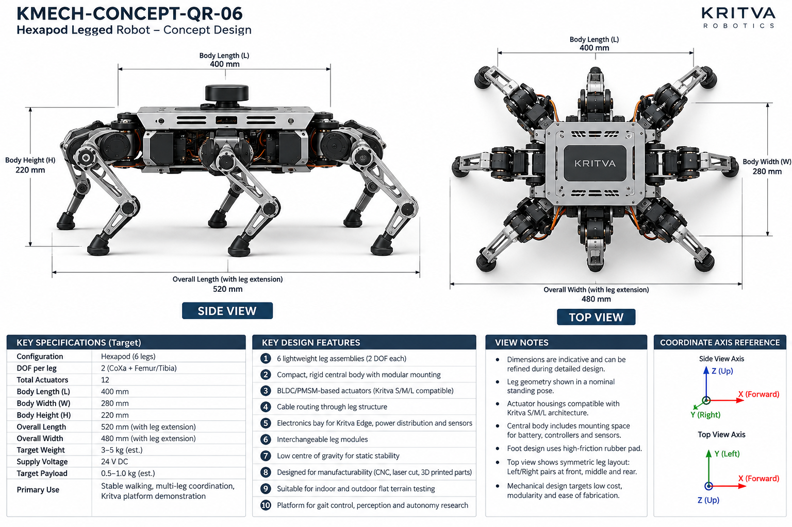
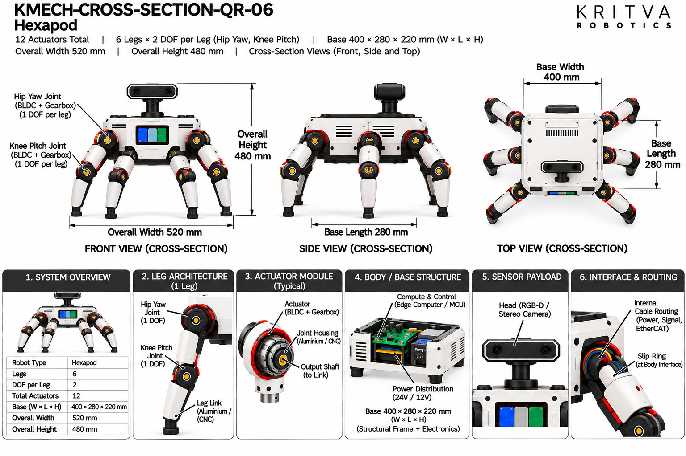

# QR-06 — Hexapod

| Property | Value |
|---|---|
| Document ID | KMECH-CONCEPT-QR-06 |
| Repository | `KritvaOS/kritva-mechanical` |
| Document Type | Concept Overview |
| Status | PROPOSED |
| Owner | Dinesh |
| Assigned Intern | INTERN-03 |
| Version | 0.3.2 |
| Last Updated | 2026-10-31 |
| Authority | Feasibility study; subject to owner review |
| Related Documents | `feasibility/STUDY_PLAN.md`, `feasibility/REQUIREMENTS_REGISTER.md`, `docs/images/ARTWORK_MANIFEST.json`, `REQUIREMENTS.md`, `ARCHITECTURE.md` |

## 1. Purpose and Scope

QR-06 is the six-legged concept: a hexapod with two DOF per leg (owner decision 2026-10-31: Hip Yaw and Knee Pitch; the concept sheet still prints coxa and femur/tibia), 12 actuators, and a low centre of gravity for statically stable walking and multi-leg coordination. This README records the printed values of both sheets and decides neither. It does not approve any value.

- Concept ID: QR-06
- Concept name: Hexapod
- Family: Legged
- Complexity: High (relative engineering category, not a validated assessment)
- Assigned intern: INTERN-03
- Assessment revision: none yet (NOT STARTED)

## 2. Reference Artwork

*Concept sheet: `docs/images/KMECH-CONCEPT-QR-06.png`. This is the primary configuration reference.*

*Cross-section sheet: `docs/images/KMECH-CROSS-SECTION-QR-06.png`. This is an illustrative internal arrangement.*

Both sheets are concept artwork (evidence type C, PROPOSED, maturity L0 as proposed in the planning discussion). They are not to scale, are not CAD, and are not engineering evidence. The earlier `.svg` sketch is superseded by these sheets.

## 3. Configuration

| Item | Value | Source |
|---|---|---|
| Robot type | Hexapod legged robot, six legs, rigid central body | Concept and Cross-section |
| Legs | 6 (left and right pairs at front, middle and rear) | Concept and Cross-section |
| DOF per leg | 2 (Hip Yaw, Knee Pitch; owner decision 2026-10-31) | Cross-section; concept sheet prints coxa + femur/tibia |
| Total leg DOF / actuators | 12 (6 × 2) | Concept and Cross-section |
| Feet | High-friction rubber pad (concept); interchangeable rubber or TPU with 6-axis optional force sensor (cross-section) | Concept and Cross-section |
| Sensors and compute | Concept: space for battery, controllers and sensors. Cross-section: Kritva Edge and an optional top sensor module (RGB-D camera and IMU), height adjustable | Concept and Cross-section |
| Environment | Indoor and outdoor flat terrain testing | Concept |

## 4. CONCEPT_TARGET

Every value is printed on the artwork and is `CONCEPT_TARGET`: indicative, unapproved, and not a requirement. Requirements-register values stay `UNKNOWN` or `TBD` until the owner resolves them. Where the sheets disagree, both values are shown and marked `DISCREPANCY — OWNER REVIEW`; nothing is chosen by inference.

| Item | Value as printed | Source sheet | Status |
|---|---|---|---|
| Total actuators | 12 | Concept and Cross-section | CONCEPT_TARGET |
| Leg count | 6 | Concept and Cross-section | CONCEPT_TARGET |
| Body length (L) | 400 mm | Concept and Cross-section | CONCEPT_TARGET |
| Body width (W) | 280 mm | Concept and Cross-section | CONCEPT_TARGET |
| Body height (H) | 220 mm | Concept and Cross-section | CONCEPT_TARGET |
| Overall length (with leg extension) | 520 mm | Concept and Cross-section | CONCEPT_TARGET |
| Overall width (with leg extension) | 480 mm | Concept and Cross-section | CONCEPT_TARGET |
| Target weight | 3 – 5 kg (est.) | Concept | CONCEPT_TARGET |
| Target payload | 0.5 – 1.0 kg (est.) | Concept | CONCEPT_TARGET |
| Supply voltage | 24 V DC (concept-level power indication, not a confirmed electrical interface) | Concept and Cross-section | CONCEPT_TARGET |
| Power rails shown inside | 24 V in; 5 V and 12 V rails | Cross-section | CONCEPT_TARGET |
| Primary use | Stable walking, multi-leg coordination, gait control, perception and autonomy research, Kritva platform demonstration | Concept | CONCEPT_TARGET |
All dimensions, DOF and actuator counts printed on both sheets agree after the cross-section sheets were regenerated on 2026-10-31. A value printed on one sheet only names that sheet. The concept sheet's own view notes say dimensions are indicative. Items not printed on either sheet (for example joint torque, speed, stride, battery capacity, camera models) stay TBD.

## 5. Mechanical Architecture

Subsystem-level description from the sheets. Materials and mechanisms are options shown on the artwork, not selections. There is no CAD. The cross-section sheet is not used to infer hexapod internals because it shows a different robot.

| Element | What the artwork shows | Status |
|---|---|---|
| Body | Compact rigid central body with modular mounting, electronics bay for Kritva Edge, power distribution and sensors; top sensor puck shown on the concept render | Illustrative |
| Legs | Six lightweight interchangeable leg assemblies of two joints each, arranged in left and right pairs at front, middle and rear | Illustrative; see D1 |
| Joint assemblies | BLDC/PMSM actuator housings compatible with Kritva S/M/L architecture (concept); the cross-section shows Hip Yaw and Knee Pitch joints with BLDC and gearbox | Illustrative |
| Feet | High-friction rubber pad (concept) | Illustrative |
| Body mounting interface | Not shown on the regenerated cross-section (the earlier sheet showed 4 × M5 holes and 2 × Ø5 mm dowels as "indicative concept") | Illustrative; D6 resolved |
| Sensor module | Optional top sensor module on a height-adjustable mount | Optional |

## 6. Joint and Actuator Mapping

Mapping as printed on the concept sheet. Motor model, torque, speed, gear ratio and S/M/L assignment are not given by any approved source and stay TBD.

| Joint or actuator | Intended motion or axis | DOF | Proposed technology (as shown) | Baseline or optional |
|---|---|---|---|---|
| Hip Yaw (each leg) | Hip joint of the leg, yaw axis (owner decision 2026-10-31); concept sheet name: coxa | 1 | BLDC/PMSM, Kritva S/M/L compatible | Baseline |
| Knee Pitch (each leg) | Leg bend joint, pitch axis (owner decision 2026-10-31); concept sheet name: femur/tibia | 1 | BLDC/PMSM, Kritva S/M/L compatible | Baseline |

Count: 2 DOF × 6 legs = 12 actuators; both sheets state 12. The owner decided on 2026-10-31 that the two actuated joints are Hip Yaw and Knee Pitch, one DOF each (D2 resolved); the cross-section uses these names and the concept sheet still prints coxa and femur/tibia. The concept sheet calls the actuators Kritva S/M/L compatible; this study has not mapped any joint to S, M or L.

## 7. Electronics and Power

Block-level placement and interfaces as shown on the sheets; there is no wiring schematic.

| Block | What the artwork shows | Status |
|---|---|---|
| Kritva Edge (compute and control) | Board in the central body | Illustrative; board dimensions TBD |
| Power distribution | 24 V in with 5 V and 12 V rails | Illustrative; electrical requirements TBD |
| Battery, controllers | Space in the central body (concept); no battery is drawn on the cross-section | Illustrative; capacity and layout TBD |
| Sensors | Optional top sensor module (RGB-D camera and IMU), height adjustable; USB / MIPI sensor interface | Optional; sensor selection TBD |

## 8. Cable Routing and Serviceability

Routes as labelled on the cross-section sheet ('cable routing through leg') and on the concept sheet. No harness design is implied.

- Cable routing runs through the leg structure and links (both sheets).
- Concern to investigate: six legs with two joints each means twelve joint harnesses and a denser hip region than any quadruped concept; not designed here.

## 9. Risks and Unknowns

1. The slip ring labelled "at body interface" on the cross-section (D8) is not on the concept sheet; its effect on six-leg packaging is UNKNOWN until the owner decides.
2. Kinematics, workspace and gait planning can start from Hip Yaw and Knee Pitch; the joint axis directions and limits are still not stated on either sheet.
3. Two-DOF planar legs cannot move laterally; turning and sideways motion of a hexapod with 2-DOF legs depend on the hip axis, which is UNKNOWN.
4. Twelve actuators at 3 – 5 kg (est.) leave little mass per leg; actuator sizing and S/M/L compatibility are unassessed.
5. Packaging: six hip interfaces on a 400 mm × 280 mm body leave little room for battery and electronics; not assessed.
6. Printed weight and payload targets have no stated basis.

## 10. Artwork Discrepancies

| ID | Discrepancy | Sheets | Status |
|---|---|---|---|
| D1 | Leg count and DOF: 6 legs with 2 DOF each (concept) vs a four-legged robot with 3 DOF per leg (cross-section) | Both | RESOLVED (cross-section regenerated 2026-10-31); the cross-section now shows a hexapod with 2 DOF per leg |
| D2 | Joint definition: the concept sheet lists "Coxa + Femur/Tibia" as 2 DOF | Both | RESOLVED (owner decision 2026-10-31): the two actuated joints are Hip Yaw and Knee Pitch, one DOF each; the cross-section uses these names; the concept sheet still prints coxa + femur/tibia and is to be aligned when next regenerated |
| D3 | Body size: 400 × 280 × 220 mm (concept) vs 1000 × 420 × 520 mm (cross-section) | Both | RESOLVED (cross-section regenerated 2026-10-31); both print 400 × 280 × 220 mm, overall 520 × 480 mm |
| D4 | Titles and extras: 'Modular / Expandable', payload bay, advanced sensors and 'Kritva Nexus' on the cross-section | Cross-section | RESOLVED (cross-section regenerated 2026-10-31); removed |
| D5 | Weight and payload appear on the concept sheet only | Concept | NOT VERIFIABLE FROM CURRENT ARTWORK |
| D6 | Body mounting interface (4 × M5 holes, 2 × Ø5 mm dowels) was "indicative concept" on the earlier cross-section and was not on the concept sheet | Cross-section | RESOLVED (cross-section regenerated 2026-10-31); the interface is not shown on the current cross-section |
| D7 | Cross-section subtitle printed the body size as "400 × 280 × 280 × 220 mm" (duplicated 280) | Cross-section | RESOLVED (cross-section regenerated 2026-10-31); it now reads 400 × 280 × 220 mm (W × L × H) |
| D8 | The regenerated cross-section labels a "Slip Ring (at Body Interface)" in section 6; the concept sheet and this README name no slip ring | Cross-section | OPEN — OWNER REVIEW; NOT VERIFIABLE FROM CURRENT ARTWORK |

The two sheets agree on six legs, 2 DOF per leg, 12 actuators, body 400 × 280 × 220 mm and overall 520 × 480 mm (width × height on the cross-section). The title now reads "Hexapod". Review status: concept sheet `REVIEWED_WITH_ISSUES` (D2 wording), cross-section `REVIEWED_WITH_ISSUES` (D8) in `docs/images/ARTWORK_MANIFEST.json` (Claude audit round 7; owner confirmation pending). REVIEWED is not design approval.

## 11. Feasibility Activity and Evidence

What the assigned intern investigates, using paper methods only (calculations, comparison tables, sketches and cited datasheets):

- [ ] Draw the hexapod leg kinematic sketch with frames for Hip Yaw and Knee Pitch (D2 resolved; evidence C)
- [ ] Draw tripod-gait support polygons and estimate static stability margin for the six-leg arrangement (evidence C)
- [ ] Estimate static joint torque for a stated body mass in tripod stance (evidence C)
- [ ] Estimate mass by subsystem with assumptions listed, separately from the printed 3 – 5 kg (evidence C)
- [ ] Sketch a body layout with six hip interfaces, battery and electronics (evidence C)
- [ ] List harness paths through six legs (evidence C)
- [ ] Record intern-generated cost assumptions separately from printed targets; no quotation or procurement

## 12. Revision and Traceability

| Item | Value |
|---|---|
| README revision | 0.3.1 |
| Concept sheet | `docs/images/KMECH-CONCEPT-QR-06.png` |
| Cross-section sheet | `docs/images/KMECH-CROSS-SECTION-QR-06.png` |
| Manifest | `docs/images/ARTWORK_MANIFEST.json` |
| Review state | Artwork audited by Claude (round 6, 2026-10-31); owner confirmation pending. This README records what the artwork prints and does not approve any value |

## 13. Folder Contents

This README and the two artwork sheets exist today. The files and folders below are created by the assigned intern as work progresses, using `feasibility/templates/`. There is no `cad/` folder while HOLD D-003 is active.

- `REQUIREMENTS.md`
- `ARCHITECTURE.md`
- `MECHANICAL_ANALYSIS.md`
- `ACTUATOR_ANALYSIS.md`
- `INTERFACES.md`
- `MASS_BUDGET.md`
- `COST_MODEL.md`
- `OPEN_QUESTIONS.md`
- `calculations/`
- `references/`
- `reviews/`
- `sketches/`

## 14. Current Assessment

- Overall status: NOT STARTED (README expanded from the artwork on 2026-10-31; no feasibility assessment has been performed)
- Requirements completeness: TBD
- Architecture assessment: TBD
- Engineering assessment: TBD
- Actuator compatibility: TBD
- Cost assessment: TBD
- Major risks: TBD
- Evidence gaps: TBD

## 15. Checkpoint Progress

| Checkpoint | Status | Review reference |
|---|---|---|
| CP2 | TBD | `reviews/` |
| CP3 | TBD | `reviews/` |
| CP4 | TBD | `reviews/` |

## 16. Open Decisions

1. Joint axis directions and limits for Hip Yaw and Knee Pitch (names decided 2026-10-31).
2. Whether the slip ring at the body interface (D8) is kept; it is on the cross-section only.
3. The concept sheet wording (coxa + femur/tibia) to be aligned with Hip Yaw and Knee Pitch when next regenerated.
4. Weight and payload targets remain `UNKNOWN` in the requirements register until resolved.
5. Joint to S/M/L actuator mapping is not started.

## 17. HOLD D-003

Paper feasibility work only. CAD, final BOM, quotations, procurement, fabrication, assembly and physical testing remain NOT STARTED and require explicit owner decision. This template does not authorize implementation.
